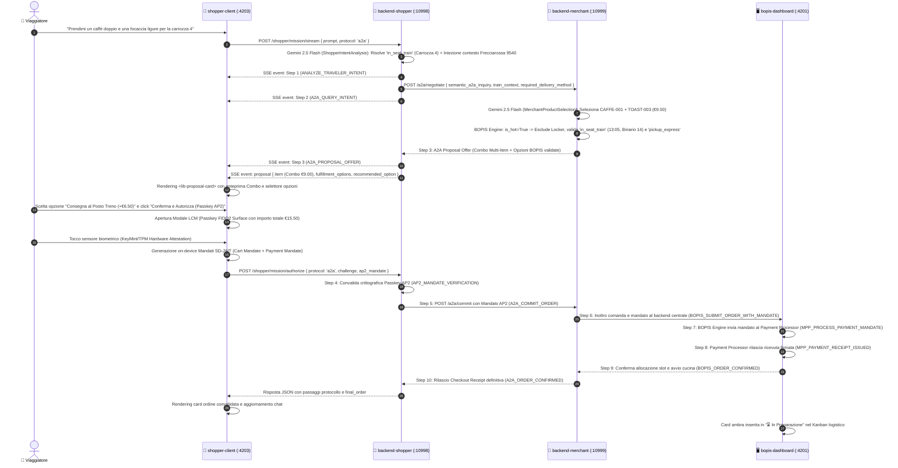
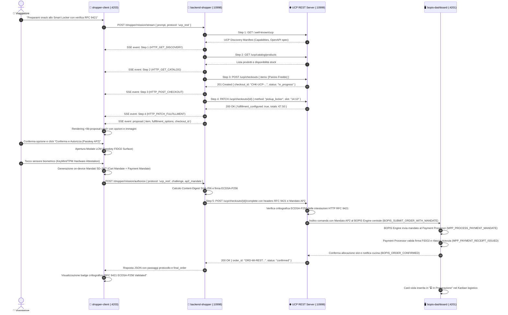
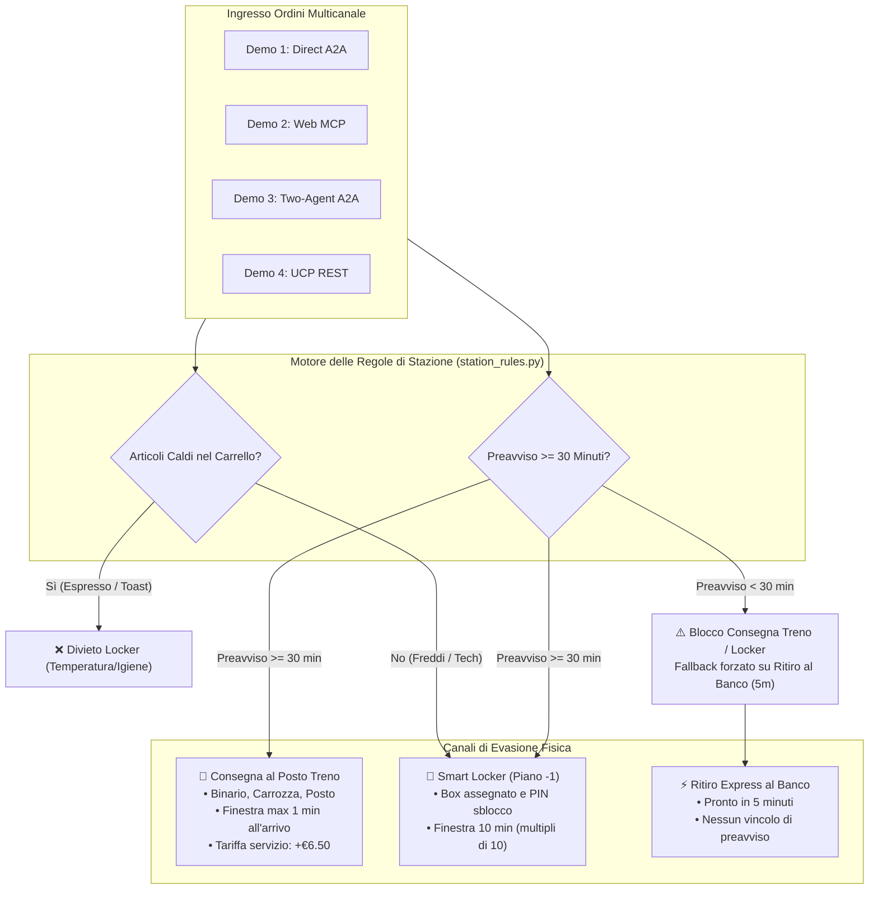
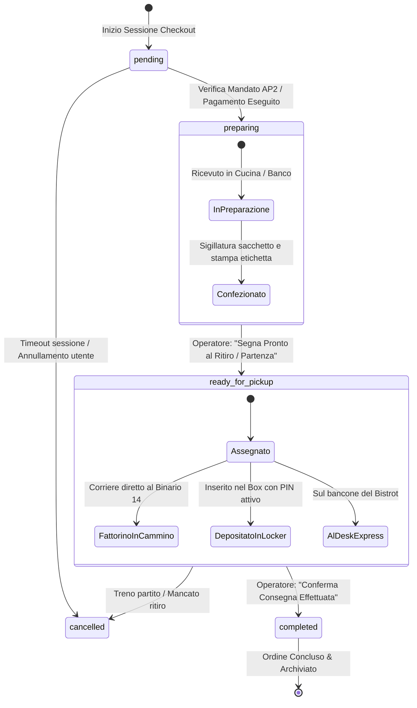
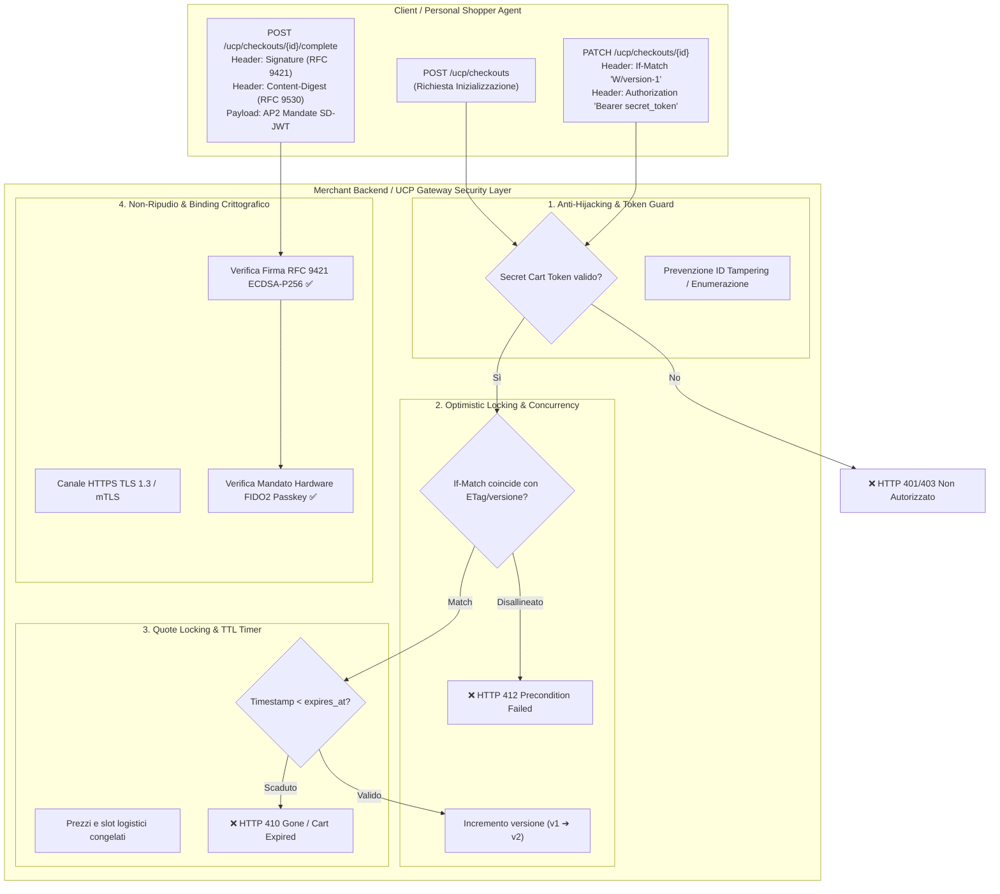

# Architettura di Sistema Globale: UCP Travel Retail Demo Hub
**GDG DevFest Milano 2026** — *Agentic Commerce across UCP, Web MCP, and Physical Retail*

Questo documento costituisce la specifica architetturale definitiva per l'intera soluzione implementata nel monorepo `ucp-demo-mi-devfest2026`. Illustra la topologia distribuita a microservizi, le librerie condivise, i 4 canali di interazione a confronto (Direct A2A, Web MCP, Two-Agent Federation, UCP REST Binding), la crittografia dei mandati AP2 e delle firme HTTP RFC 9421, la sicurezza con Firebase Auth e il motore logistico di stazione (BOPIS Dispatcher Hub).

---

## 1. Visione d'Insieme & Standard Aperti

La soluzione dimostra come l'e-commerce evolva verso l'**Agentic Commerce**: una rete aperta e interoperabile in cui assistenti AI personali, agenti di vendita, piattaforme e-commerce e punti di ritiro fisici cooperano senza monopoli né piattaforme proprietarie a silos.

I tre pilastri tecnologici a standard aperti alla base del sistema sono:
1. **Universal Commerce Protocol (UCP)**: Protocollo standard aperto (creato da Google in collaborazione con partner retail come Shopify, Walmart, Target) che standardizza la Discovery (`/.well-known/ucp`), i carrelli, il checkout, le modalità di ritiro (BOPIS) e i webhook.
2. **Agent Payment Protocol (AP2)**: Protocollo di pagamento crittografico con mandati delegati non ripudiabili (SD-JWT, firme hardware TPM/Passkey FIDO2), che permette a un agente AI di acquistare per conto dell'utente entro limiti certi di spesa e tempo senza richiedere l'interazione umana per ogni singolo clic.
3. **Model Context Protocol (Web MCP)**: Standard promosso per esporre tool e risorse di un'applicazione web nativa direttamente agli agenti AI (sia on-device via browser che server-to-server).

---

## 2. Topologia Globale del Monorepo Nx

L'architettura comprende **4 applicazioni front-end Angular 22**, **2 backend Python**, **2 librerie condivise (frontend e backend)** e il tier serverless su **Google Cloud Platform (GCP)**:

```mermaid
flowchart TD
    %% TIER 1: FRONTENDS
    subgraph Frontends ["Front-End Applications Tier (Angular 22 Standalone Signals)"]
        ChatClient["📱 chat-client (:4200)<br/>Demo 1: Baseline A2A Conversazionale"]
        BopisDashboard["🖥️ bopis-dashboard (:4201)<br/>Station Dispatcher Hub Omnichannel"]
        StorefrontMcp["🛍️ storefront-webmcp (:4202)<br/>Demo 2: Web E-Commerce con Web MCP"]
        ShopperClient["🤖 shopper-client (:4203)<br/>Demo 3 & 4: Split-View Chat + Protocol Inspector"]
    end

    %% TIER 2: SHARED LIBRARIES
    subgraph SharedLibs ["Shared Core Libraries"]
        SharedFE["📦 libs/shared-frontend<br/>• Traveler Context Models<br/>• TravelerTicketCardComponent<br/>• TravelerContextModalComponent<br/>• TravelerLcmModalComponent (FIDO2 Passkey)<br/>• ProtocolInspectorComponent (Universal Inspector)<br/>• ProtocolStep & Event Models"]
        SharedBE["🐍 backend/src/shared<br/>• Pydantic Models (Ticket, AP2, Order)<br/>• station_rules.py (Termica & 30m)<br/>• ap2_crypto.py (SD-JWT Mandates)<br/>• rfc9421.py (ECDSA-P256 Signatures)"]
    end

    %% TIER 3: BACKENDS
    subgraph Backends ["Backend Services Tier (Python Microservices)"]
        BackendShopper["🧠 backend-shopper (:10998)<br/>Personal Shopper Agent Service<br/>• Semantic Intent Engine (Gemini 2.5 Flash)<br/>• Context Engine (In-Memory & Presets)<br/>• Mission SSE Streamer (/shopper/mission/stream)<br/>• A2A & REST Orchestrator"]
        
        BackendMerchant["🏪 backend-merchant (:10999)<br/>Milano Centrale Retail Hub<br/>• Google ADK & Merchant Agent (Gemini 2.5 Flash)<br/>• A2A JSON-RPC 2.0 & Semantic Handler (/api, /a2a)<br/>• Web MCP Server (/mcp, /mcp/tools)<br/>• UCP REST Server (/ucp/checkouts, RFC 9421)<br/>• BOPIS Store Engine (/bopis/orders)"]
    end

    %% TIER 4: CLOUD
    subgraph CloudTier ["☁️ Google Cloud Platform Tier (agentic-comm-mi-devfest-2026)"]
        FirebaseAuth["Firebase Authentication<br/>Google Sign-In (OAuth2 / OIDC)"]
        FirestoreDB[("Cloud Firestore<br/>Collection: 'bopis_orders'")]
        VertexGemini["Google Gemini 2.5 Flash<br/>(Structured Outputs via Google GenAI)"]
    end

    %% DEPENDENCY & USAGE LINKS
    ChatClient --> SharedFE
    ShopperClient --> SharedFE
    BackendShopper --> SharedBE
    BackendMerchant --> SharedBE

    %% TRAFFIC FLOWS
    ChatClient -->|A2A JSON-RPC| BackendMerchant
    StorefrontMcp -->|Web MCP Tools / HTTP| BackendMerchant
    
    ShopperClient -->|HTTP Context & SSE Stream| BackendShopper
    BackendShopper -->|A2A M2M Semantic Negotiation| BackendMerchant
    BackendShopper -->|UCP REST + RFC 9421 Signatures| BackendMerchant

    BackendMerchant <-->|ADK LLM Function Calling| VertexGemini
    BackendMerchant -->|Persistenza Ordini Convalidati| FirestoreDB

    %% REAL-TIME DISPATCHING
    FirestoreDB ==>|Real-time onSnapshot Push| BopisDashboard
    BackendMerchant -.->|Fallback REST Sync (/bopis/orders)| BopisDashboard

    %% AUTHENTICATION
    ChatClient -.->|Google Identity Guard| FirebaseAuth
    BopisDashboard -.->|Google Identity Guard| FirebaseAuth
    StorefrontMcp -.->|Google Identity Guard| FirebaseAuth
    ShopperClient -.->|Google Identity Guard| FirebaseAuth
```

---

## 3. Le 4 Architetture Demo a Confronto

La suite è stata concepita per consentire allo speaker della conferenza un confronto chiaro, rigoroso e visivo tra i 4 paradigmi di integrazione agentica:

| Dimensione di Confronto | Demo 1: Direct A2A (Baseline) | Demo 2: Web MCP (E-Commerce) | Demo 3: Two-Agent Federation | Demo 4: UCP Standard REST |
| :--- | :--- | :--- | :--- | :--- |
| **Interfaccia Utente** | `chat-client` (`:4200`) | `storefront-webmcp` (`:4202`) | `shopper-client` (`:4203`) | `shopper-client` (`:4203`) |
| **Backend Coinvolti** | Solo `backend-merchant` (`:10999`) | Solo `backend-merchant` (`:10999`) | `backend-shopper` (`:10998`) $\longleftrightarrow$ `backend-merchant` (`:10999`) | `backend-shopper` (`:10998`) $\longrightarrow$ `backend-merchant` (`:10999`) |
| **Protocollo di Rete** | JSON-RPC 2.0 su HTTP POST | Model Context Protocol (MCP) | A2A Protocol semantico M2M | HTTP/1.1 RESTful UCP |
| **Protocol Inspector** | ✅ Live Inspector A2A JSON-RPC (Collassabile) | ✅ Inspector WebMCP JSON-RPC | ✅ Live Inspector A2A M2M (Split-View) | ✅ Live Inspector REST RFC 9421 (Split-View) |
| **Iniezione del Contesto** | Esplicito (l'utente scrive treno/posto in chat) | Esplicito via prompt dell'agente shopper | **Implicito automatico** (Wallet: PNR, treno, carrozza, posto) | **Implicito automatico** (Wallet e configurazione fulfillment) |
| **Firma e Pagamento** | Modale LCM AP2 on-device | Simulatore Cart Mandate AP2 | **Mandato Autonomo AP2** (FIDO2 validato entro massimale) | **Firma RFC 9421 (ECDSA-P256)** + Mandato AP2 |
| **Tag su Dispatcher Hub** | 🔵 `Demo 1: UCP Direct A2A` | 🟢 `Demo 2: Web MCP` | 🟡 `Demo 3: Two-Agent A2A M2M` | 🟣 `Demo 4: UCP REST Binding` |
| **Casi d'Uso Tipici** | Chatbot B2C e assistenti per brand singolo | Siti e-commerce esistenti che aprono API per agenti | Assistenti personali (Android, Google Pixel) che acquistano autonomamente | Piattaforme enterprise headless, integrazioni ERP/POS |

---

## 4. Diagrammi di Flusso e Sequenza

### 4.1 Demo 3: Two-Agent A2A Federation (Negoziazione Machine-to-Machine con Gemini 2.5 Flash)

Dimostra il caso d'uso in cui il viaggiatore interagisce in linguaggio naturale con il proprio **Personal Shopper Agent** (on-device/cloud personale, con accesso al biglietto ferroviario nel wallet). I due agenti collaborano tramite **Gemini 2.5 Flash** con output strutturati Pydantic:
- **Shopper Agent**: deduce l'intento dell'utente, risolve la modalità di consegna (`in_seat_train` se cita il treno/carrozza, `pickup_locker`, `pickup_express`), inietta il contesto del biglietto (treno, carrozza, posto, orario di partenza) e formula una query semantica A2A.
- **Merchant Agent**: interroga il catalogo del Bistrot (`products.json`), riconosce anche combinazioni multi-articolo (es. caffè doppio + focaccia ligure calda), applica le regole dietetiche e delega al **BOPIS Engine** la verifica termica (`is_hot`: esclude i locker) e la fattibilità logistica (consegna al posto consigliata).



---

### 4.2 Demo 4: UCP Standard REST Binding con HTTP Message Signatures (RFC 9421)

Dimostra l'implementazione del canale REST ufficiale specificato da UCP per sistemi enterprise, in cui ogni richiesta transazionale include firme crittografiche non ripudiabili generate via RFC 9421:



---

## 5. Livello di Sicurezza e Crittografia

### 5.1 Mandati Crittografici AP2 (Agent Payment Protocol)
L'integrazione di AP2 segue rigorosamente le specifiche del consorzio per la delega del potere d'acquisto agli agenti intelligenti:

1. **Modalità Human-Present (Implementata in Demo 1, Demo 3, Demo 4):**
   - **Local Credential Manager (LCM):** Componente sicuro di sistema operativo (WebAuthn / Passkey FIDO2) che presenta la richiesta di autorizzazione all'utente con il riepilogo vincolante della transazione.
   - **Cart Mandate & Payment Mandate:** Al tocco del sensore biometrico (impronta/volto), il client firma on-device i token **SD-JWT (Selective Disclosure JSON Web Token)** con la chiave privata hardware ancorata al KeyMint/TPM.
   - **Verifica Lato Ricevente:** L'agente o il server UCP valida la firma e le chiavi pubbliche del titolare prima di confermare la transazione.

2. **Modalità Human-Not-Present / Delegated Autonomous (Backlog Demo 5):**
   - **Intent Mandate Pre-Firmato:** L'utente autorizza preventivamente una delega di budget (es. massimale €40.00, scadenza 7 giorni) prima della partenza.
   - **Trigger Asincrono:** Un watcher monitora eventi di mercato (es. sconti o prezzi inferiori a soglia per prodotti desiderati come vino pregiato).
   - **Firma Headless:** L'agente esegue l'acquisto in background senza tocco umano nel rispetto dei limiti crittografici della delega.

### 5.2 Firme HTTP RFC 9421 (HTTP Message Signatures)
Per garantire che le chiamate HTTP transazionali tra agenti e server UCP non possano essere modificate da proxy né ripudiate:
- **Algoritmo**: `ecdsa-p256-sha256`.
- **Intestazioni Generate**:
  - `Content-Digest`: `sha-256=:<digest-base64>:` (garantisce l'integrità del body JSON).
  - `Signature-Input`: Definisce i componenti firmati: `sig1=("@method" "@path" "@authority" "content-digest");created=...;keyid="shopper-key-2026";alg="ecdsa-p256"`.
  - `Signature`: `sig1=:<firma-der-base64>:` (firma digitale dei metadati calcolati).
- **Verifica**: Implementata in [`backend/src/shared/rfc9421.py`](file:///c:/Projects/AgenticCommerce/prjs/ucp-demo-mi-devfest2026/backend/src/shared/rfc9421.py) e validata automaticamente su ogni checkout UCP REST.

### 5.3 Firebase Authentication (Google Identity)
- Le applicazioni web (`chat-client`, `bopis-dashboard`, `storefront-webmcp`, `shopper-client`) utilizzano **Firebase Authentication** con provider Google per l'accesso.
- La console Firebase associata al progetto GCP `agentic-comm-mi-devfest-2026` funge da directory delle identità per le prove pre-conferenza e la protezione da accessi non autorizzati.

---

## 6. Il Motore Logistico di Stazione: BOPIS Dispatcher Hub

Tutti gli ordini provenienti da qualsiasi canale (A2A, Web MCP, REST) vengono aggregati e instradati attraverso la dispatch board di stazione (`bopis-dashboard` su porta `4201`):



### Sincronizzazione Dati Ibrida
1. **Canale Real-Time Cloud (WebSockets)**: Ogni ordine confermato viene scritto sulla collection Firestore `bopis_orders`. Il front-end `bopis-dashboard` ascolta le modifiche tramite l'observer `onSnapshot` di Firebase, garantendo latenza sub-secondo per la notifica in cucina.
2. **Canale di Backup Locale Fail-Safe (REST Polling)**: In assenza di connettività Internet o durante esecuzioni offline alla conferenza, il backend merchant scrive gli ordini su `data/bopis_orders.json`. La dashboard esegue automaticamente il fallback su polling HTTP verso `GET /bopis/orders` su porta `10999`.

---

## 7. Macchina a Stati dell'Ordine

Il ciclo di vita di ogni comanda rispetta la seguente macchina a stati finiti deterministica:



---

## 8. Tabella Riassuntiva dei Servizi e Comandi Monorepo

| Progetto Monorepo | Porta | Comando Nx / Script | Dipendenze Shared |
| :--- | :---: | :--- | :--- |
| **`chat-client`** | `4200` | `npx nx run chat-client:serve` | Firebase SDK, Angular 22 |
| **`bopis-dashboard`** | `4201` | `npx nx run bopis-dashboard:serve` | Firebase Firestore, Angular 22 |
| **`storefront-webmcp`** | `4202` | `npx nx run storefront-webmcp:serve` | Web MCP Registry, Angular 22 |
| **`shopper-client`** | `4203` | `npx nx run shopper-client:serve` | `@ucp/shared-frontend`, Angular 22 |
| **`backend-shopper`** | `10998` | `npx nx run backend-shopper:serve` | `backend/src/shared`, Starlette, httpx |
| **`backend-merchant`** | `10999` | `npx nx run backend-merchant:serve` | `backend/src/shared`, FastAPI, ADK, Firestore |
| **Tutti i Servizi** | *Tutte* | `npm run serve:all` | Orchestra tutti i progetti in parallelo |
| **Test E2E Suite** | *N/A* | `python scratch/test_e2e_full.py` | Verifica completa A2A, REST RFC 9421, BOPIS |
| **Test MCP Suite** | *N/A* | `npx nx run backend-merchant:test:mcp` | 7 test automatici sul server Web MCP |

---

## 9. Roadmap Architetturale & Hardening di Sicurezza UCP

Questa sezione formalizza i requisiti di **Hardening di Sicurezza e Anti-Hijacking del Carrello/Checkout** previsti dallo standard UCP (Universal Commerce Protocol), distinguendo le responsabilità tra l'SDK ufficiale e il codice applicativo del Merchant/Backend.



### 9.1 I 4 Pilastri Anti-Hijacking in UCP

| Pilastro | Obiettivo di Sicurezza | Specifiche UCP Coinvolte | Ruolo SDK Ufficiale | Responsabilità Merchant |
| :--- | :--- | :--- | :--- | :--- |
| **A. Dual-Token Architecture** | Impedire a un attaccante di manomettere o leggere carrelli altrui indovinando o intercettando l'ID pubblico risorsa. | `specification/shopping/cart/rest.md`, `checkout/rest.md` | Nessuno (fornisce solo schemi dati `Cart`/`Checkout`). | Generazione `cart_secret_token` effimero (CSPRNG), memorizzazione su session store/DB, convalida `Bearer` su ogni endpoint. |
| **B. Optimistic Locking & Versioning** | Evitare sovrascritture concorrenti ("Lost Updates") quando più agenti, schede browser o webhook aggiornano il carrello. | RFC 7232 (`ETag`, `If-Match`), UCP REST Binding | Nessuno (definisce solo `UcpErrorResponse`). | Calcolo ETag (SHA-256 o timestamp/counter), verifica dell'header `If-Match`, emissione `412 Precondition Failed` e atomicità DB (`WHERE version = :current`). |
| **C. mTLS / TLS 1.3 + Client Binding** | Impedire Man-in-the-Middle (MitM) sul canale di trasporto e garantire l'autenticità del bot/agente chiamante. | `overview/index.md#transport-security`, `signatures.md` (RFC 9421) | Solo modelli ed esempi di digest; il binding mTLS è a livello infrastrutturale. | Configurazione HTTPS TLS 1.3 minimo, terminazione mTLS con certificati client X.509, verifica firme RFC 9421 (già implementata nella nostra demo). |
| **D. Short-Lived TTL & Quote Locking** | Fissare prezzi, promozioni e slot logistici (Smart Locker / consegna treno) per una finestra temporale certa; prevenire ordini stantii. | Campo `expires_at` in `shopping/cart.json` e `checkout.json` | Espone il campo `expires_at: datetime` nei modelli Pydantic/Zod. | Calcolo finestra temporale (es. 15 minuti), background cleaner/sweep, validazione al complete con codice `quote_expired` o `out_of_stock`. |

### 9.2 Ulteriori Evoluzioni di Identità (Identity Linking)
Oltre ai meccanismi di protezione del carrello:
- **Modalità 2 (UCP Identity Linking `dev.ucp.common.identity_linking`)**: Scambio federato di credenziali tramite standard OAuth 2.0 PKCE con discovery `/.well-known/oauth-authorization-server` e Token Exchange (RFC 8693) per collegare l'account Google con il profilo del Merchant.
- **Modalità 3 (Verifica Crittografica AP2)**: Attestazione crittografica della Passkey FIDO2 firmata on-device dal chip Secure Enclave/TPM dell'utente, senza necessità di dipendere dall'email in chiaro.

---

## 10. Traccia per la Serie di Articoli su UCP & Agentic Commerce

La demo e l'architettura implementata costituiscono una base completa per una serie organica di **5 articoli tecnici** su Medium, Dev.to o Substack:

1. **Articolo 1 — La Rivoluzione dell'Agentic Commerce: Oltre l'E-Commerce Tradizionale**
   - Dai chatbot conversazionali isolati ai protocolli aperti di cooperazione economica.
   - Perché UCP (Universal Commerce Protocol) è sostenuto da Google, Shopify e leader retail.
   - Anatomia della Discovery decentralizzata: `/.well-known/ucp` e la negoziazione delle capability.

2. **Articolo 2 — I Tre Paradigmi di Integrazione a Confronto: A2A vs Web MCP vs UCP REST**
   - Quando usare A2A (Agent-to-Agent M2M semantico), quando Web MCP (tools esposti dal browser), e quando UCP REST Binding.
   - Analisi del caso studio reale: Milano Centrale Travel Retail Hub (consegna al posto sul Frecciarossa, Smart Locker e Desk Express).
   - Iniezione implicita del contesto (biglietto ferroviario, orari, vincoli termici cibi caldi).

3. **Articolo 3 — Carrelli e Checkout nell'Era degli Agenti: Anti-Hijacking, Concorrenza e Quote Locking**
   - Perché un carrello per agenti autonomi è diverso da una sessione web tradizionale.
   - I quattro pattern di sicurezza: Dual-Token Architecture, Optimistic Locking (ETag / If-Match / 412), mTLS e Short-Lived TTL.
   - Il confine architetturale: cosa fa l'SDK ufficiale (`ucp-sdk`) e cosa spetta all'ingegneria del backend.

4. **Articolo 4 — Pagamenti Autonomi e Mandati Crittografici: Integrazione tra UCP, AP2 ed RFC 9421**
   - Il problema della delega di spesa: come permettere all'AI di pagare senza cedere la carta di credito.
   - L'Agent Payment Protocol (AP2): Intent Mandate, Cart Mandate e Payment Mandate firmati con Passkey FIDO2 / TPM.
   - HTTP Message Signatures (RFC 9421) con ECDSA-P256: garantire l'integrità del payload e la non-ripudiabilità della transazione.

5. **Articolo 5 — Omnicanalità Fisica: Il Motore BOPIS (Buy Online, Pick Up In Store) e la Logica di Stazione**
   - Dal checkout digitale al mondo fisico: coordinare cucine, baristi, corrieri al binario e Smart Locker con PIN temporanei.
   - Gestione real-time con WebSockets/Firestore e fallback locale resiliente.
   - Guida hands-on per clonare, configurare ed estendere il monorepo open-source della demo.

