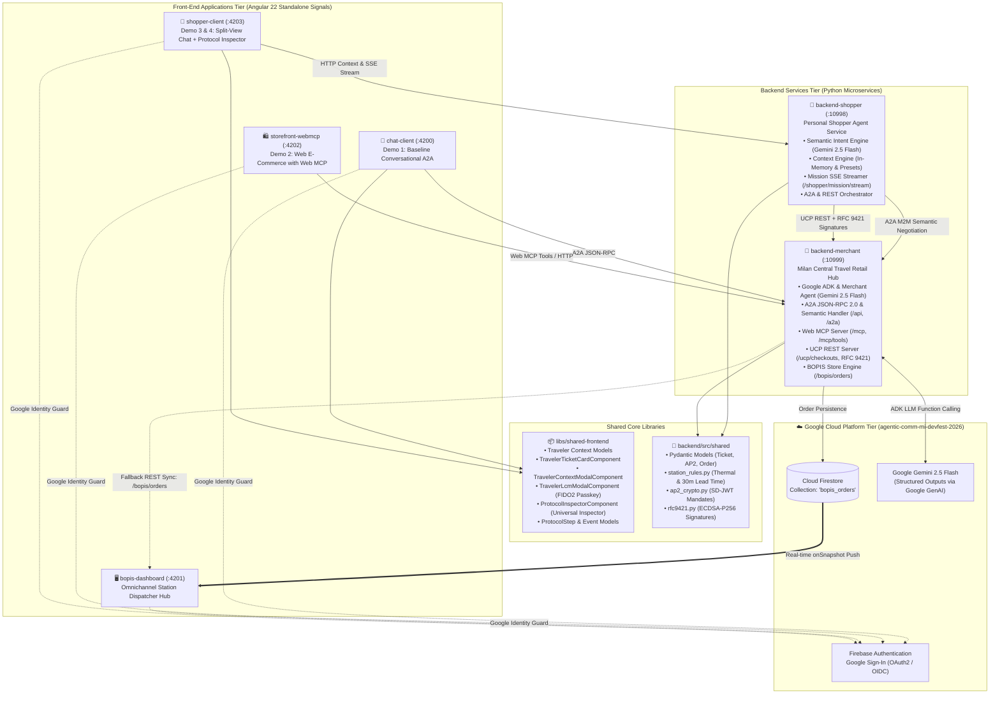
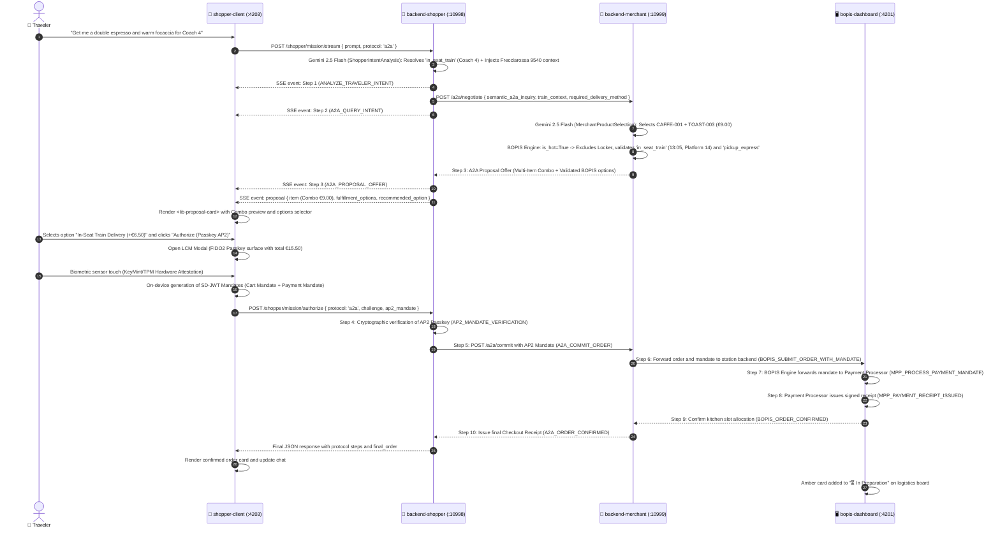
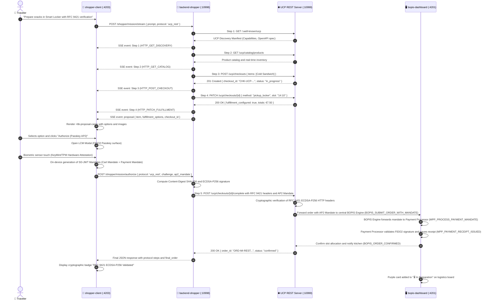
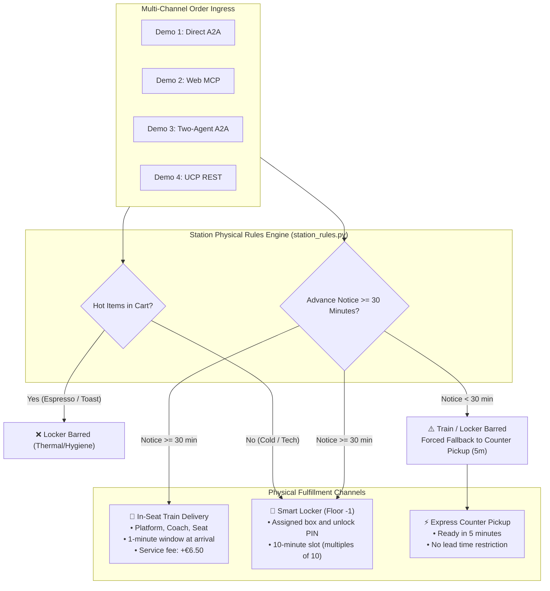
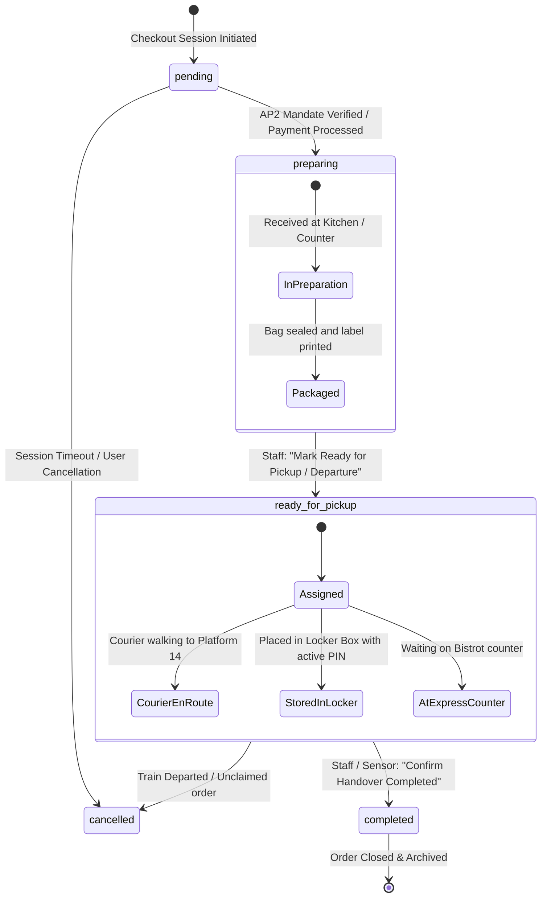
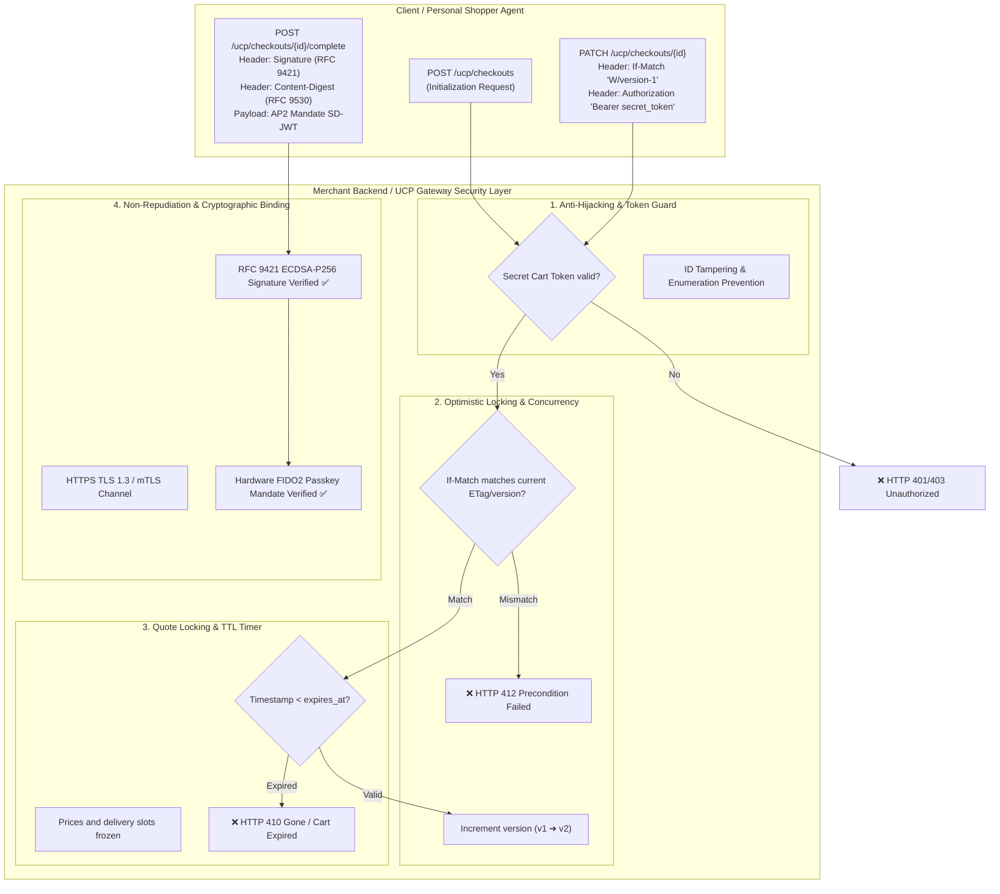

# Global System Architecture: UCP Travel Retail Demo Hub
**GDG DevFest Milano 2026** — *Agentic Commerce across UCP, Web MCP, and Physical Retail*

This document constitutes the definitive architectural specification for the entire solution implemented in the `ucp-demo-mi-devfest2026` monorepo. It details the distributed microservices topology, shared libraries, the 4 comparative interaction channels (Direct A2A, Web MCP, Two-Agent Federation, UCP REST Binding), cryptographic AP2 mandates and RFC 9421 HTTP Message Signatures, Firebase authentication, and the physical transit retail logistics engine (BOPIS Dispatcher Hub).

---

## 1. Executive Vision & Open Standards

The solution demonstrates how e-commerce evolves into **Agentic Commerce**: an open, interoperable network where personal AI assistants, merchant agents, web storefronts, and physical fulfillment hubs cooperate without proprietary walled gardens or platform monopolies.

The three core open standards underpinning the system are:
1. **Universal Commerce Protocol (UCP)**: An open standard protocol (co-developed by Google in collaboration with retail partners such as Shopify, Walmart, Target) standardizing Discovery (`/.well-known/ucp`), carts, checkout sessions, fulfillment options (BOPIS), and event webhooks.
2. **Agent Payment Protocol (AP2)**: A cryptographic payment protocol featuring non-repudiable delegated mandates (SD-JWT, Passkey FIDO2/TPM hardware-backed signatures) enabling an AI agent to execute purchases within bounded spend limits and timeframes without requiring continuous human clicks.
3. **Model Context Protocol (Web MCP)**: An open standard to expose web application tools and DOM-level actions directly to AI agents (both on-device in the browser and server-to-server).

---

## 2. Global Nx Monorepo Topology

The architecture comprises **4 Angular 22 front-end applications**, **2 Python backend microservices**, **2 shared libraries (frontend and backend)**, and serverless cloud services on **Google Cloud Platform (GCP)**:

---

## 3. The 4 Demo Architectures Compared

The suite is engineered to provide conference attendees and speakers with a clear, visual comparison across all 4 agentic commerce integration paradigms:

| Comparison Dimension | Demo 1: Direct A2A (Baseline) | Demo 2: Web MCP (E-Commerce) | Demo 3: Two-Agent Federation | Demo 4: UCP Standard REST |
| :--- | :--- | :--- | :--- | :--- |
| **User Interface** | `chat-client` (`:4200`) | `storefront-webmcp` (`:4202`) | `shopper-client` (`:4203`) | `shopper-client` (`:4203`) |
| **Backend Services** | Only `backend-merchant` (`:10999`) | Only `backend-merchant` (`:10999`) | `backend-shopper` (`:10998`) $\longleftrightarrow$ `backend-merchant` (`:10999`) | `backend-shopper` (`:10998`) $\longrightarrow$ `backend-merchant` (`:10999`) |
| **Network Protocol** | JSON-RPC 2.0 over HTTP POST | Model Context Protocol (MCP) | Semantic M2M A2A Protocol | HTTP/1.1 RESTful UCP |
| **Protocol Inspector** | ✅ Live A2A JSON-RPC Inspector (Collapsible) | ✅ WebMCP JSON-RPC Inspector | ✅ Live A2A M2M Inspector (Split-View) | ✅ Live REST RFC 9421 Inspector (Split-View) |
| **Context Injection** | Explicit (user types train/seat into chat) | Explicit via buyer agent prompt | **Implicit Automated** (Wallet: PNR, train, coach, seat) | **Implicit Automated** (Wallet & fulfillment config) |
| **Signing & Payment** | On-device AP2 LCM modal | Simulated AP2 Cart Mandate | **Autonomous AP2 Mandate** (FIDO2 validated within limit) | **RFC 9421 Signature (ECDSA-P256)** + AP2 Mandate |
| **Dispatcher Hub Badge** | 🔵 `Demo 1: UCP Direct A2A` | 🟢 `Demo 2: Web MCP` | 🟡 `Demo 3: Two-Agent A2A M2M` | 🟣 `Demo 4: UCP REST Binding` |
| **Typical Use Cases** | Single-brand B2C chatbots and conversational apps | Existing web storefronts exposing tools to agents | Personal AI assistants (Android, Google Pixel) acting autonomously | Enterprise headless commerce, ERP/POS integrations |

---

## 4. Sequence & Execution Flowcharts

### 4.1 Demo 3: Two-Agent A2A Federation (Machine-to-Machine Negotiation with Gemini 2.5 Flash)

Showcases the scenario where a traveler interacts in natural language with their own **Personal Shopper Agent** (on-device/cloud agent with direct access to train ticket details in their wallet). Both agents collaborate via **Gemini 2.5 Flash** using Pydantic Structured Outputs:
- **Shopper Agent**: Analyzes traveler intent, resolves required delivery method (`in_seat_train` if coach/seat is specified, `pickup_locker`, `pickup_express`), injects ticket context (train, coach, seat, departure time), and formulates an A2A query.
- **Merchant Agent**: Evaluates catalog inventory (`products.json`), recognizes multi-item combos (e.g. double espresso + warm focaccia toast), enforces dietary preferences, and delegates physical verification to the **BOPIS Engine** (`is_hot` excludes lockers, validates lead time).

---

### 4.2 Demo 4: UCP Standard REST Binding with HTTP Message Signatures (RFC 9421)

Demonstrates the official UCP REST binding specified for enterprise environments, where every transactional mutation includes non-repudiable cryptographic signatures via RFC 9421:

---

## 5. Security Architecture & Cryptographic Layer

### 5.1 AP2 Cryptographic Mandates (Agent Payment Protocol)
The AP2 integration follows the consortium specification for delegating purchasing authority to AI agents:

1. **Human-Present Mode (Implemented in Demo 1, Demo 3, Demo 4):**
   - **Local Credential Manager (LCM):** Operating system secure element interface (WebAuthn / Passkey FIDO2) presenting the authorization dialog with the immutable transaction summary.
   - **Cart Mandate & Payment Mandate:** Upon biometric confirmation, the client signs **SD-JWT (Selective Disclosure JSON Web Tokens)** on-device using hardware private keys bound to the KeyMint/TPM.
   - **Receiver-Side Verification:** The merchant or UCP server verifies the signature and public keys before settling transactions.

2. **Human-Not-Present / Delegated Autonomous Mode (Roadmap Demo 5 / [TODO-02](../TODO.md)):**
   - **Pre-Signed Intent Mandate:** The user authorizes a pre-approved budget envelope (e.g. max €40.00, 7-day validity) prior to departure.
   - **Asynchronous Watcher:** A background monitor detects price drop triggers (e.g. promotional discounts on premium wine).
   - **Headless Signing:** The agent completes the purchase autonomously within cryptographic bounds.

### 5.2 RFC 9421 HTTP Message Signatures
Ensures transactional HTTP exchanges between agents and UCP servers cannot be modified in transit or repudiated:
- **Algorithm**: `ecdsa-p256-sha256`.
- **Generated Headers**:
  - `Content-Digest`: `sha-256=:<digest-base64>:` (guarantees JSON body integrity per RFC 9530).
  - `Signature-Input`: Declares signed components: `sig1=("@method" "@path" "@authority" "content-digest");created=...;keyid="shopper-key-2026";alg="ecdsa-p256"`.
  - `Signature`: `sig1=:<der-signature-base64>:` (digital signature of normalized metadata).
- **Verification**: Implemented in [`backend/src/shared/rfc9421.py`](../backend/src/shared/rfc9421.py) and verified automatically on each UCP REST checkout completion.

### 5.3 Firebase Authentication (Google Identity)
- Web applications (`chat-client`, `bopis-dashboard`, `storefront-webmcp`, `shopper-client`) use **Firebase Authentication** with Google Sign-In.
- The Firebase console associated with GCP project `agentic-comm-mi-devfest-2026` provides the identity directory.

---

## 6. Station Transit Fulfillment Engine: BOPIS Dispatcher Hub

All orders across all channels (A2A, Web MCP, UCP REST) aggregate into the central station dispatch board (`bopis-dashboard` on port `4201`):

### Hybrid Data Synchronization
1. **Cloud Real-Time Channel (WebSockets)**: Confirmed orders write to Firestore collection `bopis_orders`. The `bopis-dashboard` listens via Firebase `onSnapshot` observers, guaranteeing sub-second kitchen notifications.
2. **Local Fail-Safe Backup (REST Polling)**: When offline, the merchant backend persists orders to `data/bopis_orders.json`. The dashboard automatically falls back to HTTP polling `GET /bopis/orders` on port `10999`.

---

## 7. Order State Machine

The lifecycle of each order follows a deterministic finite state machine:

---

## 8. Monorepo Project Map & Commands

| Project | Port | Nx Command | Shared Dependencies |
| :--- | :---: | :--- | :--- |
| **`chat-client`** | `4200` | `npx nx run chat-client:serve` | Firebase SDK, Angular 22 |
| **`bopis-dashboard`** | `4201` | `npx nx run bopis-dashboard:serve` | Firebase Firestore, Angular 22 |
| **`storefront-webmcp`** | `4202` | `npx nx run storefront-webmcp:serve` | Web MCP Registry, Angular 22 |
| **`shopper-client`** | `4203` | `npx nx run shopper-client:serve` | `@ucp/shared-frontend`, Angular 22 |
| **`backend-shopper`** | `10998` | `npx nx run backend-shopper:serve` | `backend/src/shared`, Starlette, httpx |
| **`backend-merchant`** | `10999` | `npx nx run backend-merchant:serve` | `backend/src/shared`, FastAPI, ADK, Firestore |
| **All Services** | *All* | `npm run serve:all` | Orchestrates all 6 projects concurrently |
| **E2E Test Suite** | *N/A* | `python scratch/test_e2e_full.py` | Validates A2A, REST RFC 9421, BOPIS |
| **MCP Test Suite** | *N/A* | `npm run test:mcp` | 7 automated tests on Web MCP server |

---

## 9. Architectural Roadmap & UCP Security Hardening

This section outlines the **Cart Anti-Hijacking and Security Hardening** requirements mandated by UCP, delineating responsibilities between the official SDK and merchant application logic:

### 9.1 The 4 Anti-Hijacking Pillars in UCP

| Pillar | Security Objective | Relevant UCP Specs | Official SDK Scope | Merchant Responsibilities |
| :--- | :--- | :--- | :--- | :--- |
| **A. Dual-Token Architecture** | Prevent attackers from tampering with or reading carts by guessing public resource IDs. | `specification/shopping/cart/rest.md`, `checkout/rest.md` | Data schemas only (`Cart`/`Checkout`). | Ephemeral `cart_secret_token` generation (CSPRNG), session store persistence, `Bearer` token enforcement. |
| **B. Optimistic Locking & Versioning** | Prevent concurrent overwrite ("Lost Updates") when multiple agents or webhooks update carts. | RFC 7232 (`ETag`, `If-Match`), UCP REST Binding | Defines `UcpErrorResponse`. | ETag computation, `If-Match` header validation, `412 Precondition Failed` emission, atomic DB update (`WHERE version = :current`). |
| **C. mTLS / TLS 1.3 + Client Binding** | Prevent Man-in-the-Middle (MitM) and verify calling agent identity. | `overview/index.md#transport-security`, `signatures.md` (RFC 9421) | Digest schemas and models. | HTTPS TLS 1.3 termination, client X.509 pinning, RFC 9421 signature verification (implemented in our demo). |
| **D. Short-Lived TTL & Quote Locking** | Freeze pricing, promotions, and logistics slots (lockers / train delivery) for a defined window. | `expires_at` in `shopping/cart.json` and `checkout.json` | Exposes `expires_at: datetime` field. | Time window calculation (e.g. 15 min), background TTL sweeper, validation upon completion returning `quote_expired`. |

---

## 10. Technical Articles Outline (Agentic Commerce Series)

The demo serves as the foundation for an organized series of **5 technical articles**:

1. **Article 1 — The Agentic Commerce Revolution: Beyond Traditional E-Commerce**
   - From isolated chatbots to open economic cooperation protocols.
   - Why UCP (Universal Commerce Protocol) is backed by Google, Shopify, and global retailers.
   - Decentralized discovery: `/.well-known/ucp` and capability negotiation.

2. **Article 2 — Three Integration Paradigms Compared: A2A vs. Web MCP vs. UCP REST**
   - When to use A2A (semantic M2M), Web MCP (browser tool execution), and UCP REST.
   - Case study: Milan Central Travel Retail Hub (in-seat train delivery, Smart Locker, express desk).
   - Implicit context injection (train tickets, timetables, thermal food restrictions).

3. **Article 3 — Carts & Checkouts for Autonomous Agents: Concurrency & Quote Locking**
   - Why shopping carts for AI agents differ fundamentally from human web sessions.
   - The four security patterns: Dual-Token, Optimistic Locking (ETag/If-Match), mTLS, and Short-Lived TTL.
   - Architecture boundaries: SDK responsibilities vs. merchant backend engineering.

4. **Article 4 — Autonomous Payments & Cryptographic Mandates: UCP, AP2 & RFC 9421**
   - The spending delegation challenge: how AI pays safely without holding raw credit card numbers.
   - Agent Payment Protocol (AP2): Intent, Cart, and Payment Mandates backed by FIDO2 Passkeys.
   - RFC 9421 HTTP Message Signatures with ECDSA-P256 for non-repudiation.

5. **Article 5 — Physical Omnichannel Fulfillment: BOPIS & Transit Station Logistics**
   - Bridging digital checkout with physical retail: kitchens, couriers, and PIN-secured Smart Lockers.
   - Real-time event propagation via WebSockets/Firestore with resilient local fail-safe fallback.
   - Hands-on guide to cloning, running, and extending the open-source demo repository.
