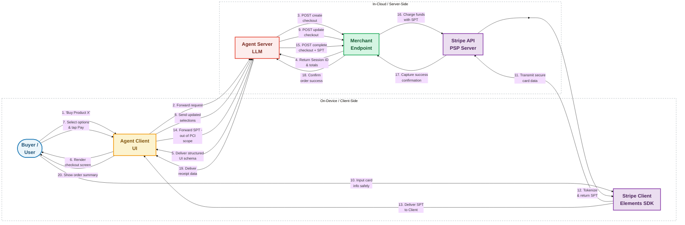
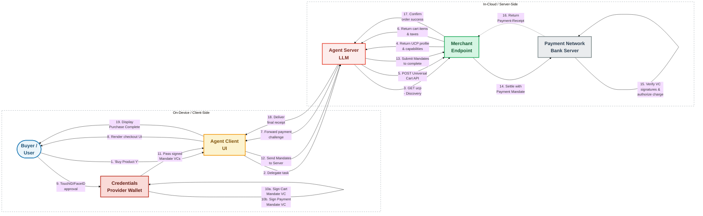
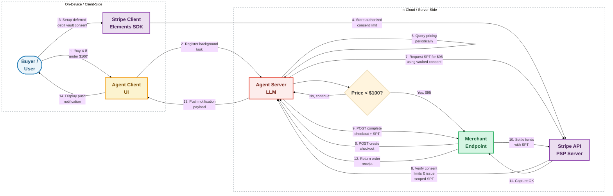
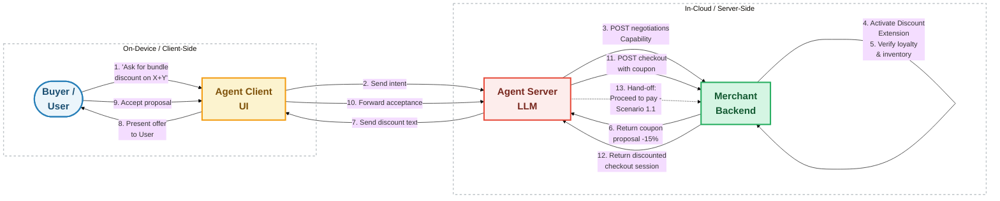
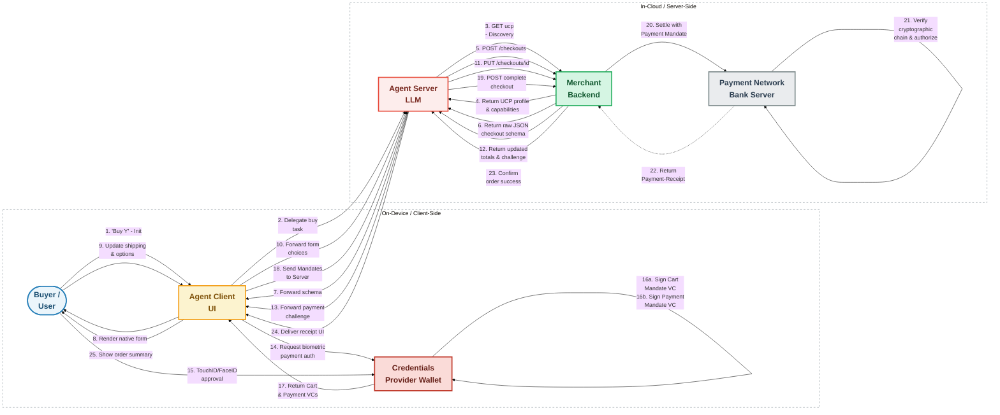
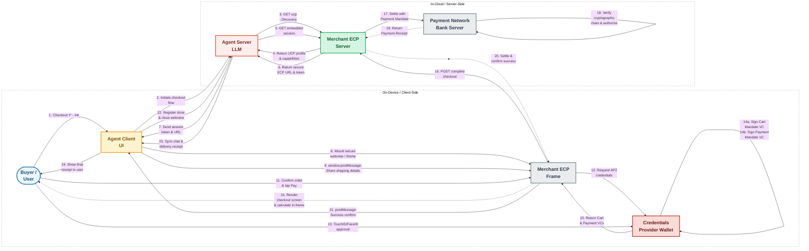

# Technical Flowcharts (High-Legibility Slide Edition v21): Agent Client vs. Agent Server

This document presents high-resolution, presentation-optimized **Mermaid Flowcharts (flowchart LR)** mapping the execution logic, decision trees, and cryptographic steps of **ACP** and **UCP + AP2**.

To maximize legibility within slide decks, these flowcharts:
1. **Use Left-to-Right layout (`flowchart LR`)** instead of Top-Down (`graph TD`) to naturally fit 16:9 presentation slides.
2. **Increase spacing and use smooth curves** using Mermaid config (`nodeSpacing: 75`, `rankSpacing: 140`, `curve: 'basis'`).
3. **Declare logical nodes inside explicit Subgraphs on EVERY scenario** to physically cluster them into **Local [On-Device / Client-Side]** and **Cloud [In-Cloud / Server-Side]** environments. This mathematically guarantees that client-side components like `Stripe Client` or `Wallet` stay grouped on the left, preventing Mermaid's layout engine from pulling them to the right and ensuring absolute visual consistency across the entire slide deck.
4. **Avoid parentheses in connection labels** (e.g. replacing `- Discovery` instead of `(Discovery)`) as Mermaid's parser interprets parentheses as shape borders and throws syntax errors.
5. **Group self-loops and consecutive steps** into a single arc using HTML ` ` line breaks (bypassing the mermaid.live multiple self-loop rendering bug).
6. **Separate Client-side vs. Server-side counterparts symmetrically**:
    * **Stripe Client (Elements SDK)** vs. **Stripe Server (PSP API)** in ACP.
    * **Credentials Provider (Wallet)** vs. **Payment Issuer (Bank Server)** in AP2.
    * **Merchant ECP Frame** vs. **Merchant ECP Server** in UCP Embedded.
7. **Integrate UCP Discovery explicitly** (`GET /.well-known/ucp` and `GET /.well-known/agent-card.json` for A2A) in all relevant UCP/AP2 scenarios to ensure absolute technical rigor and slide independence.
8. **Ensure actor consistency**: The user's cloud-hosted orchestrator is uniformly named `Agent Server LLM` across all scenarios.

---

## SCENARIO 1: Human-Present (Real-Time Conversational Purchase)

### 1.1 ACP Flow (Stripe / OpenAI)
This flowchart shows how Stripe's secure Elements are embedded on the Client device, bypassing the Server entirely for raw payment entry to maintain strict PCI compliance.

---

### 1.2 UCP + AP2 Flow (Google / Shopify)
This flowchart illustrates the use of on-device biometric validation to authorize the cryptographically secure **Cart Mandate** and **Payment Mandate** credentials.

---

---

### 1.3 UCP Standard Flow (Google Pay / Shop Pay - Without AP2)
This flowchart shows a native UCP checkout using a traditional Payment Handler (e.g. Google Pay or Shop Pay) when the AP2 Mandates extension is not negotiated.

```mermaid
%%{init: {
  'theme': 'base',
  'flowchart': {
    'nodeSpacing': 75,
    'rankSpacing': 140,
    'curve': 'basis'
  }
}}%%
flowchart LR
    %% Shared base styles (large bold text, distinct borders)
    classDef default font-size:22px,font-weight:bold,stroke-width:3px;

    %% Palette colors with dark contrasting text
    classDef buyer fill:#EBF5FB,stroke:#2980B9,color:#1B4F72;
    classDef client fill:#FCF3CF,stroke:#F39C12,color:#7E5109;
    classDef wallet fill:#FADBD8,stroke:#C0392B,color:#641E16;
    classDef server fill:#FDEDEC,stroke:#E74C3C,color:#78281F;
    classDef merchant fill:#D5F5E3,stroke:#27AE60,color:#145A32;
    classDef psp fill:#EBDEF0,stroke:#8E44AD,color:#4A235A;

    subgraph Local [On-Device / Client-Side]
        User([Buyer /<br/>User])
        Client[Agent Client<br/>UI]
        Wallet[Credentials<br/>Provider Wallet]
    end

    subgraph Cloud [In-Cloud / Server-Side]
        Server[Agent Server<br/>LLM]
        Merchant[Merchant<br/>Endpoint]
        PSP[Merchant PSP<br/>Gateway]
    end

    User -->|1. 'Buy Product Y'| Client
    Client -->|2. Delegate task| Server
    Server -->|3. GET ucp<br/>- Discovery| Merchant
    Merchant -->|4. Return profile<br/>& Payment Handlers| Server
    Server -->|5. POST /checkouts| Merchant
    Merchant -->|6. Return checkout<br/>& Handlers| Server
    Server -->|7. Forward checkout<br/>& Handlers| Client
    Client -->|8. Render UI &<br/>Payment Button| User
    User -->|9. Tap Pay &<br/>TouchID/FaceID| Wallet
    Wallet -->|10. Issue tokenized<br/>Payment Credential| Client
    Client -->|11. Send Payment<br/>Credential| Server
    Server -->|12. POST complete<br/>checkout + Token| Merchant
    Merchant -->|13. Charge token<br/>via PSP| PSP
    PSP -->|14. Confirm charge<br/>success| Merchant
    Merchant -->|15. Confirm<br/>order success| Server
    Server -->|16. Deliver final<br/>receipt| Client
    Client -->|17. Display<br/>Purchase Complete| User

    class User buyer;
    class Client client;
    class Wallet wallet;
    class Server server;
    class Merchant merchant;
    class PSP psp;

    style Local fill:none,stroke:#BDC3C7,stroke-width:2px,stroke-dasharray: 5 5;
    style Cloud fill:none,stroke:#BDC3C7,stroke-width:2px,stroke-dasharray: 5 5;
```

## SCENARIO 2: Human-Not-Present (Asynchronous / Delegated Purchase)

### 2.1 ACP Flow (Stripe / OpenAI)
This flowchart details how the backend Agent Server triggers an asynchronous purchase without client-side user intervention, utilizing pre-authorized consent registered in Stripe's vaults.

---

### 2.2 UCP + AP2 Flow (Google / Shopify)
This flowchart demonstrates how the local Agent Client background daemon validates the transaction against the **Intent Mandate** and signs the transaction credentials on-device, completely headless.

```mermaid
%%{init: {
  'theme': 'base',
  'flowchart': {
    'nodeSpacing': 75,
    'rankSpacing': 140,
    'curve': 'basis'
  }
}}%%
flowchart LR
    %% Shared base styles (large bold text, distinct borders)
    classDef default font-size:22px,font-weight:bold,stroke-width:3px;

    %% Palette colors with dark contrasting text
    classDef buyer fill:#EBF5FB,stroke:#2980B9,color:#1B4F72;
    classDef client fill:#FCF3CF,stroke:#F39C12,color:#7E5109;
    classDef wallet fill:#FADBD8,stroke:#C0392B,color:#641E16;
    classDef server fill:#FDEDEC,stroke:#E74C3C,color:#78281F;
    classDef merchant fill:#D5F5E3,stroke:#27AE60,color:#145A32;
    classDef issuer fill:#EAECEE,stroke:#7F8C8D,color:#2C3E50;

    subgraph Local [On-Device / Client-Side]
        User([Buyer /<br/>User])
        Wallet[Credentials<br/>Provider Wallet]
        Client[Agent Client<br/>Daemon]
    end

    subgraph Cloud [In-Cloud / Server-Side]
        Server[Agent Server<br/>LLM]
        Merchant[Merchant Endpoint<br/>UCP]
        Issuer[Payment Network<br/>Bank Server]
        ConditionCheck{Match found es. $90?}
    end

    User -->|1. Setup limits<br/>Max $100| Wallet
    Wallet -->|2. Issue Intent<br/>Mandate VC| Client
    Client -->|3. Register task<br/>+ Intent VC| Server
    Server -->|4. GET ucp<br/>- Discovery| Merchant
    Merchant -->|5. Return UCP profile<br/>& capabilities| Server
    Server -->|6. Monitor price<br/>& stock| Server
    Server --> ConditionCheck
    ConditionCheck -->|No| Server
    ConditionCheck -->|Yes| Merchant
    Merchant -->|7. Return checkout<br/>challenge| Server
    Server -->|8. Request background<br/>signing| Client
    Client <-->|9. Query validation<br/>Wallet verifies<br/>limits & signs<br/>Mandate VCs| Wallet
    Client -->|10. Send Mandates<br/>to Server| Server
    Server -->|11. Submit Mandates<br/>to complete| Merchant
    Merchant -->|12. Process with<br/>chained Mandates| Issuer
    Issuer -->|13. Verify<br/>cryptographic<br/>chain & authorize| Issuer
    Issuer -.->|14. Return<br/>Payment-Receipt| Merchant
    Merchant -->|15. Confirm order| Server
    Server -->|16. Push success<br/>confirmation| Client
    Client -->|17. Show Purchase<br/>Done alert| User

    class User buyer;
    class Wallet wallet;
    class Client client;
    class Server server;
    class Merchant merchant;
    class Issuer issuer;

    style Local fill:none,stroke:#BDC3C7,stroke-width:2px,stroke-dasharray: 5 5;
    style Cloud fill:none,stroke:#BDC3C7,stroke-width:2px,stroke-dasharray: 5 5;
```

---

## SCENARIO 3: Personalized Offer Negotiation

### 3.1 ACP Flow (Stripe / OpenAI)
This flowchart shows how negotiations on discounts occur programmatically at the Agent Server level based on discount extensions.

---

### 3.2 UCP + A2A Flow (Google / Shopify)
This flowchart maps out how the Buyer's Agent Server establishes an **Agent2Agent (A2A)** connection to negotiate deals with the Merchant's internal, autonomous **NAT Agents**.

```mermaid
%%{init: {
  'theme': 'base',
  'flowchart': {
    'nodeSpacing': 75,
    'rankSpacing': 140,
    'curve': 'basis'
  }
}}%%
flowchart LR
    %% Shared base styles (large bold text, distinct borders)
    classDef default font-size:22px,font-weight:bold,stroke-width:3px;

    %% Palette colors with dark contrasting text
    classDef buyer fill:#EBF5FB,stroke:#2980B9,color:#1B4F72;
    classDef client fill:#FCF3CF,stroke:#F39C12,color:#7E5109;
    classDef server fill:#FDEDEC,stroke:#E74C3C,color:#78281F;
    classDef merchant fill:#D5F5E3,stroke:#27AE60,color:#145A32;
    classDef nat fill:#EAECEE,stroke:#7F8C8D,color:#2C3E50;

    subgraph Local [On-Device / Client-Side]
        User([Buyer /<br/>User])
        Client[Agent Client<br/>UI]
    end

    subgraph Cloud [In-Cloud / Server-Side]
        Server[Agent Server<br/>LLM]
        MerchantEndpoint[Merchant A2A<br/>Endpoint]
        NAT[Merchant NAT<br/>Agents]
    end

    User -->|1. 'Plan trip &<br/>negotiate bundle'| Client
    Client -->|2. Pass context & goal| Server
    Server -->|3. GET .well-known/ucp<br/>- Discovery<br/>GET agent-card.json<br/>- A2A Skills| MerchantEndpoint
    MerchantEndpoint -->|4. Return UCP profile<br/>& signed Agent Card| Server
    Server -->|5. Open secure A2A<br/>connection &<br/>share context| MerchantEndpoint
    MerchantEndpoint -->|6. Route inquiry| NAT
    NAT -->|7a. Pricing Agent<br/>computes margin<br/>7b. Promotion Agent<br/>creates proposal<br/>7c. Sign Offer VC| NAT
    NAT -->|8. Deliver<br/>Signed Offer| MerchantEndpoint
    MerchantEndpoint -->|9. Return structured<br/>A2A response| Server
    Server -->|10. Translate offer<br/>to chat| Client
    Client -->|11. Show proposal<br/>details in chat| User
    User -->|12. Tap Accept<br/>Bundle| Client
    Client -->|13. Initiate AP2<br/>Payment| Server
    Server -.->|14. Hand-off:<br/>Proceed to AP2<br/>secured checkout| MerchantEndpoint

    class User buyer;
    class Client client;
    class Server server;
    class MerchantEndpoint merchant;
    class NAT nat;

    style Local fill:none,stroke:#BDC3C7,stroke-width:2px,stroke-dasharray: 5 5;
    style Cloud fill:none,stroke:#BDC3C7,stroke-width:2px,stroke-dasharray: 5 5;
```

---

## SCENARIO 4: UCP Checkout Variations

### 4.1 UCP Native Checkout API
In Native Checkout, the Agent Client manages the complete form validation and layout rendering on-device, processing a raw JSON challenge received by the Agent Server from the Merchant's API.

---

### 4.2 UCP Embedded Checkout (ECP)
In ECP, the Agent Client hosts a cross-origin webview/iframe belonging directly to the Merchant. Safe token sharing is maintained on-device using HTML5 secure cross-origin postMessage APIs.

