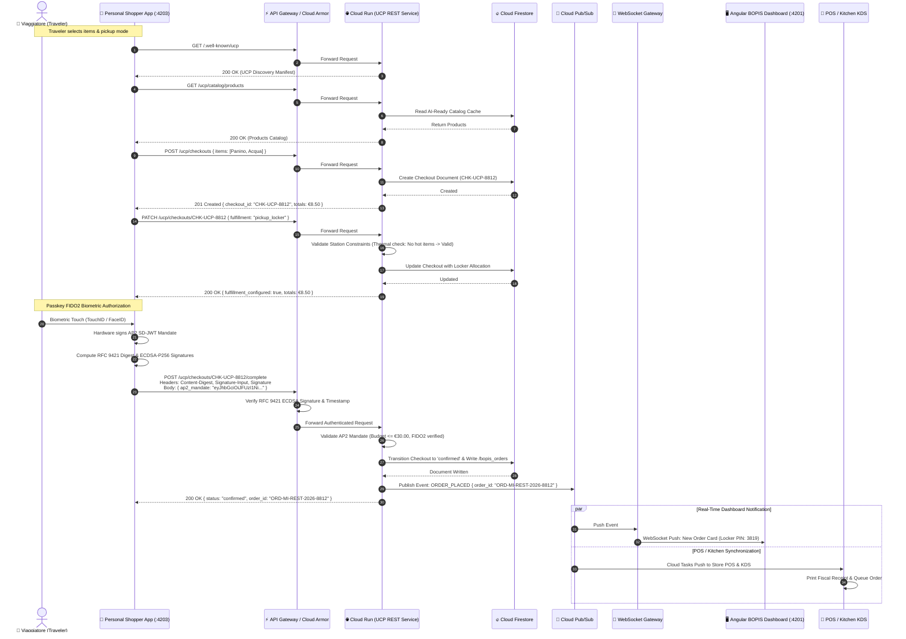
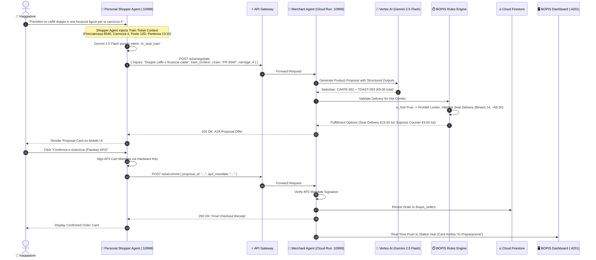

# Cloud-Native UCP Merchant Middleware: System Architecture on Google Cloud Platform
**Universal Commerce Protocol (UCP), Agentic Commerce & Physical Retail Integration**

> **Reference Context**: GDG DevFest Milano 2026 — *Agentic Commerce: Redefining E-Commerce across UCP, Web MCP, and Physical Retail* (`docs/speech.md`, Demo 3 "Two-Agent Federation", Demo 4 "UCP Standard REST Binding").

---

## 1. Executive Summary & Vision

E-commerce is undergoing a paradigm shift: transitioning from human-in-the-loop web/mobile browsing to **Agentic Commerce**, where autonomous AI agents discover, negotiate, configure, and purchase goods on behalf of users. When the primary counterpart of an e-commerce platform is an AI agent running on a smartphone, vehicle, or cloud agent runtime rather than a human clicking on a screen, the architecture of e-commerce systems must adapt:

1. **Sub-second, machine-readable protocol endpoints**: Discovery manifests (`/.well-known/ucp`), standardized checkout state machines, and cryptographically verified payload exchanges.
2. **"AI-Ready" data structures**: Product catalogs enriched with semantic context, dietary constraints, thermal requirements, and real-time inventory.
3. **Cryptographic trust and non-repudiation**: Verifying buyer mandates via **Agent Payment Protocol (AP2)** Passkeys/FIDO2 SD-JWTs and HTTP requests via **RFC 9421 HTTP Message Signatures**.
4. **Physical and digital workflow convergence (BOPIS)**: Seamlessly dispatching orders to physical transit hubs (such as railway stations and airports) with context-aware delivery methods (in-seat train delivery, smart lockers, express counter pickup) while syncing with legacy Point of Sale (POS), ERP, and Kitchen Display Systems (KDS).

This document specifies the complete production-grade system architecture for a **Serverless UCP Merchant Middleware** deployed on **Google Cloud Platform (GCP)**. It serves as the official architecture reference for deploying UCP services on top of existing e-commerce backends.

### 1.1 Key Architectural Decisions & Executive Takeaways

| Dimension | Architectural Choice | GCP Services & Standards |
| :--- | :--- | :--- |
| **1. System Scope & Role** | **Merchant UCP Serverless Middleware**: Decoupled middleware exposing standard UCP REST and A2A interfaces to external AI shoppers on top of existing e-commerce platforms. | Cloud Run, Cloud Firestore, Vertex AI, UCP Specification `2026-01-23`. |
| **2. Edge Security & Cryptography** | **API Gateway Edge Ingress (Primary)**: Google Cloud Armor + API Gateway / Apigee validates TLS and **RFC 9421 HTTP Signatures (`ecdsa-p256`)**. Cloud KMS manages merchant keys; **AP2 SD-JWT** Passkey/FIDO2 mandates validated before PSP settlement. *(In-process Cloud Run verification documented as alternative).* | Cloud Armor, API Gateway, Cloud KMS, AP2 Protocol (FIDO2 Passkeys). |
| **3. Hybrid Intelligence** | **Gemini 2.5 Flash + Deterministic BOPIS Engine**: Vertex AI handles semantic product discovery, multi-item combos, and dietary constraints; deterministic engine validates physical rules (thermal limits & train lead times). | Vertex AI (Gemini 2.5 Flash with Pydantic Structured Outputs), `station_rules.py`. |
| **4. Physical Retail Dispatch** | **Pub/Sub Fan-Out & Managed WebSockets**: Cloud Pub/Sub pushes live orders to Cloud Run WebSocket gateway for the dedicated Angular dashboard (`bopis-dashboard`); Cloud Tasks reliably syncs orders with store POS cash registers and kitchen KDS. | Cloud Pub/Sub, Cloud Run WebSockets, Cloud Tasks, Angular 22 Dashboard. |
| **5. Reference Blueprint** | **Direct Mapping to Demo 3 & Demo 4**: Bridges M2M semantic negotiation between Personal Shoppers and Merchants (Demo 3) and formal enterprise REST checkout with RFC 9421 signatures (Demo 4). | `backend-shopper` (:10998), `backend-merchant` (:10999), `shopper-client` (:4203). |

---

## 2. Core Architectural Principles & Scope

```
   ┌────────────────────────────────────────────────────────────────────────┐
   │                       SYSTEM BOUNDARY & SCOPE                          │
   │                                                                        │
   │   [External AI Agents]               [Merchant Systems]                │
   │   • Personal Shopper Agents          • Core E-Commerce (Shopify/ERP)   │
   │   • LLM Shopper Runtimes             • Physical Retail (BOPIS/POS/KDS) │
   │                │                                   ▲                   │
   │                ▼                                   │                   │
   │   ┌────────────────────────────────────────────────────────────────┐   │
   │   │     GCP SERVERLESS UCP MERCHANT MIDDLEWARE (THIS SYSTEM)       │   │
   │   │  • API Gateway / Armor (RFC 9421 Ingress & Security)           │   │
   │   │  • Cloud Run (UCP REST Server, A2A Agent, WebSockets)          │   │
   │   │  • Vertex AI (Gemini 2.5 Flash Semantic Engine)                │   │
   │   │  • BOPIS Rules Engine (Thermal, Timing & Transit Logistics)    │   │
   │   │  • Cloud Firestore (AI-Ready Catalog & Session State)          │   │
   │   │  • Pub/Sub & Cloud Tasks (POS, KDS, & IoT Locker Dispatch)     │   │
   │   └────────────────────────────────────────────────────────────────┘   │
   └────────────────────────────────────────────────────────────────────────┘
```

The system is designed around five core pillars:

- **Pluggable E-Commerce Adapter with AI-Ready Cache**: Decouples existing commerce backends (Shopify, ERP, custom headless APIs) from AI agent traffic. Cloud Firestore acts as a high-speed, low-latency read cache storing optimized "AI-Ready" catalog representations and active checkout sessions.
- **Dual Protocol Binding**: Simultaneously exposes the official **UCP Standard REST Binding** (with RFC 9421 ECDSA-P256 signatures, as in Demo 4) and the **A2A (Agent-to-Agent) Semantic Protocol** (using Gemini 2.5 Flash structured outputs, as in Demo 3).
- **Hybrid Intelligence & Deterministic Rules**: Combines the semantic understanding of **Vertex AI (Gemini 2.5 Flash)** for fuzzy discovery, multi-item combo bundling, and cross-selling with a deterministic **BOPIS Logistics Engine** that enforces physical physical retail constraints (thermal food limits, platform lead times, train schedules).
- **Edge Cryptographic Security**: Leverages **Google Cloud Armor** and **API Gateway / Apigee** for ingress routing and signature validation, integrated with **Google Cloud KMS** for key management and **AP2 (Agent Payment Protocol)** SD-JWT mandate verification.
- **Omnichannel Real-Time Dispatching**: Uses **Cloud Pub/Sub** and **Managed WebSockets on Cloud Run** to feed dedicated Angular station dashboards (`bopis-dashboard`), while leveraging **Cloud Tasks** to reliably push orders to physical Point of Sale (POS) and Kitchen Display Systems (KDS).

---

## 3. High-Level GCP System Topology

> 🖼️ **Official Google Cloud Architecture Diagram (Rendered as Code)**:
> This architecture is compiled as code using the Python `diagrams` library with official Google Cloud icons ([`docs/diagrams/gcp_architecture.py`](./diagrams/gcp_architecture.py)).
> 
> 
> *(Vector SVG edition available at: [`docs/images/ucp_gcp_architecture.svg`](./images/ucp_gcp_architecture.svg))*

The Mermaid diagram below provides the corresponding inline flowchart representation:

```mermaid
flowchart TD
    %% EXTERNAL ACTORS & CLIENTS
    subgraph ExternalClients ["External AI Shopper Ecosystem"]
        ShopperAgent["🤖 Personal Shopper Agent<br/>(Gemini 2.5 Flash / On-Device / Cloud)<br/>[Reference: Demo 3 & Demo 4]"]
        WebShopper["🛍️ Web / Headless Client<br/>(Browser / Web MCP Client)"]
        ExternalLLM["🌐 3rd-Party Agentic Networks<br/>(OpenAI Operator, Google Assistant)"]
    end

    %% GOOGLE CLOUD INGRESS & SECURITY
    subgraph IngressTier ["Ingress & Edge Security Layer (GCP)"]
        CloudDNS["🌍 Cloud DNS<br/>ucp.merchant.com"]
        CloudArmor["🛡️ Google Cloud Armor<br/>• DDoS & WAF Protection<br/>• IP Rate Limiting & Geo-fencing"]
        ApiGateway["⚡ Google Cloud API Gateway / Apigee<br/>• Route Matching (/.well-known/ucp, /ucp/*, /a2a/*)<br/>• TLS Termination<br/>• RFC 9421 Signature Verification Filter<br/>• API Token & OAuth2 Validation"]
    end

    %% GOOGLE CLOUD COMPUTE TIER
    subgraph ComputeTier ["Serverless Compute Tier (Google Cloud Run)"]
        subgraph UcpCoreService ["Cloud Run: ucp-merchant-service"]
            RestHandler["🌐 UCP REST Controller<br/>• /.well-known/ucp Manifest<br/>• /ucp/catalog/products<br/>• /ucp/checkouts (CRUD & Complete)"]
            A2AHandler["🤝 A2A Negotiation Controller<br/>• /a2a/negotiate (Semantic Inquiries)<br/>• /a2a/commit (Autonomous Orders)"]
            McpHandler["🔧 Web MCP Server Bridge<br/>• /mcp/tools (Catalog & Cart Tools)"]
            BopisEngine["⏱️ BOPIS Deterministic Engine<br/>• Thermal Rules (Hot items block Locker)<br/>• 30-min Lead Time Validation<br/>• Seat & Platform Window Calculator"]
            Ap2Verifier["🔐 AP2 Mandate Verifier<br/>• SD-JWT Verification (Passkey FIDO2)<br/>• Cart & Payment Mandate Validation"]
            AdapterCore["🔌 Pluggable Commerce Adapter<br/>• Shopify / ERP / POS Sync Engine"]
        end

        subgraph WsGatewayService ["Cloud Run: bopis-websocket-gateway"]
            WsServer["📡 Managed WebSocket Gateway<br/>• Bi-directional Sub-second Push<br/>• Station Dispatcher Hub Connection"]
        end
    end

    %% INTELLIGENCE TIER
    subgraph IntelligenceTier ["Intelligence Tier (Google Vertex AI)"]
        GeminiFlash["🧠 Gemini 2.5 Flash (Vertex AI)<br/>• Structured Outputs (Pydantic Enforcement)<br/>• Semantic Product Discovery & Combos<br/>• Traveler Intent & Dietary Resolution"]
        VectorSearch["🔍 Vertex AI Vector Search<br/>• Embeddings: text-embedding-005<br/>• Hybrid Semantic Catalog Search"]
    end

    %% SECURITY & KEY MANAGEMENT
    subgraph SecurityTier ["Key Management & Identity (GCP)"]
        CloudKMS["🔑 Google Cloud KMS<br/>• Merchant ECDSA Signing Keys<br/>• Verification Keys for RFC 9421"]
        SecretManager["🔒 Secret Manager<br/>• PSP API Keys (Stripe, Adyen, Bank Gateway)<br/>• ERP & Commerce OAuth Secrets"]
    end

    %% DATA PERSISTENCE TIER
    subgraph DataTier ["Persistence Tier (Google Cloud Firestore & Storage)"]
        FirestoreDB[("🔥 Cloud Firestore (Multi-Region Native)<br/>━━━━━━━━━━━━━━━━━━━━━━━━━━━━━<br/>• /catalogs: AI-Ready Product Cache<br/>• /checkouts: Active Sessions & Carts<br/>• /bopis_orders: Order Lifecycle & History<br/>• /keys: Shopper Public Key Directory")]
        CloudStorage[("🪣 Cloud Storage (GCS)<br/>• Product Images & High-Res Assets<br/>• UCP Capability Schemas & OpenAPI Docs")]
    end

    %% EVENT & ASYNC BROKER TIER
    subgraph EventTier ["Event & Async Messaging Tier (GCP)"]
        PubSubOrders["📨 Cloud Pub/Sub: topic 'ucp-order-events'<br/>• Event: ORDER_PLACED, PAYMENT_CONFIRMED"]
        CloudTasks["⚡ Cloud Tasks: queue 'pos-kitchen-sync'<br/>• Guaranteed Delivery with Exponential Backoff<br/>• Rate-limited Push to Store POS & ERP"]
    end

    %% PHYSICAL RETAIL & ENTERPRISE INTEGRATIONS
    subgraph PhysicalRetailTier ["Physical Retail & Fulfillment Endpoints"]
        BopisDashboardApp["🖥️ BOPIS Dispatcher Dashboard<br/>(Angular 22 - bopis-dashboard :4201)<br/>• Kitchen & Barista Prep Screen<br/>• Platform Courier Dispatch Board"]
        PosKdsSystem["🧾 Store POS System & Kitchen KDS<br/>• Cash Registers (Fiscale)<br/>• Kitchen Display System Displays"]
        SmartLockers["🔐 IoT Smart Locker Fleet<br/>• PIN Allocation & Locker Door Relays"]
    end

    subgraph ExternalEnterprise ["External Merchant & Financial Services"]
        CoreEcommerce["🏬 Core E-Commerce Platform<br/>(Shopify, BigCommerce, SAP Commerce, Custom ERP)"]
        PaymentProcessor["💳 Merchant Payment Provider (MPP)<br/>(Stripe, Adyen, Nexi, Worldline)"]
    end

    %% TRAFFIC FLOW ARROWS
    ShopperAgent -->|HTTPS REST RFC 9421 or A2A| CloudDNS
    WebShopper -->|HTTPS Web MCP| CloudDNS
    ExternalLLM -->|HTTPS UCP REST| CloudDNS

    CloudDNS --> CloudArmor
    CloudArmor --> ApiGateway
    ApiGateway -->|Authenticated Ingress| RestHandler
    ApiGateway -->|Authenticated Ingress| A2AHandler
    ApiGateway -->|Authenticated Ingress| McpHandler

    %% INTELLIGENCE CALLS
    A2AHandler <-->|Semantic Parsing & Combo Bundling| GeminiFlash
    RestHandler <-->|Vector Catalog Lookup| VectorSearch
    GeminiFlash -.->|Catalog Context Retrieval| FirestoreDB

    %% COMPUTE INTERNAL FLOWS
    RestHandler --> BopisEngine
    A2AHandler --> BopisEngine
    RestHandler --> Ap2Verifier
    A2AHandler --> Ap2Verifier
    Ap2Verifier <-->|Key Verification| CloudKMS
    Ap2Verifier <-->|Payment Execution| PaymentProcessor

    %% DATA LAYER ACCESS
    RestHandler <-->|Read Cache & Session State| FirestoreDB
    A2AHandler <-->|Order State Management| FirestoreDB
    AdapterCore <-->|Catalog & Stock Sync| CoreEcommerce

    %% EVENT FAN-OUT
    RestHandler -->|Publish Confirmed Order| PubSubOrders
    A2AHandler -->|Publish Confirmed Order| PubSubOrders

    PubSubOrders -->|Push Subscription| WsServer
    PubSubOrders -->|Trigger Event| CloudTasks

    WsServer ==>|Live WebSockets| BopisDashboardApp
    CloudTasks -->|Signed HTTP POST| PosKdsSystem
    CloudTasks -->|IoT Webhook| SmartLockers

    classDef gcp fill:#e8f0fe,stroke:#1a73e8,stroke-width:2px,color:#174ea6;
    classDef client fill:#fef7e0,stroke:#f9ab00,stroke-width:2px,color:#b06000;
    classDef physical fill:#e6f4ea,stroke:#137333,stroke-width:2px,color:#0d652d;
    classDef external fill:#fce8e6,stroke:#d93025,stroke-width:2px,color:#a50e0e;

    class CloudDNS,CloudArmor,ApiGateway,RestHandler,A2AHandler,McpHandler,BopisEngine,Ap2Verifier,AdapterCore,WsServer,GeminiFlash,VectorSearch,CloudKMS,SecretManager,FirestoreDB,CloudStorage,PubSubOrders,CloudTasks gcp;
    class ShopperAgent,WebShopper,ExternalLLM client;
    class BopisDashboardApp,PosKdsSystem,SmartLockers physical;
    class CoreEcommerce,PaymentProcessor external;
```



---

## 4. Deep-Dive Component Architecture

### 4.1 Ingress, Edge Security & Cryptographic Verification

The system receives high-value transactional requests from AI agents. Ensuring message integrity, authenticity, and non-repudiation is paramount.

#### Primary Pattern: API Gateway / Apigee Edge Verification
In the primary production topology:
1. **Google Cloud Armor** operates at Layer 7, mitigating Layer 3/4 volumetric attacks, rate-limiting malicious IPs, and applying OWASP Core Rule Sets (CRS).
2. **Google Cloud API Gateway / Apigee** acts as the managed ingress controller:
   - Terminates TLS (mTLS optionally supported for accredited agent networks).
   - Validates standard request semantics and extracts headers.
   - Executes an **RFC 9421 signature verification policy**:
     - Reads `Content-Digest`, `Signature-Input`, and `Signature`.
     - Validates the `@method`, `@path`, `@authority`, and `content-digest` components.
     - Retrieves the agent’s registered public key from Cloud KMS or the cached key store in Firestore.
   - Forwards authenticated requests to the Cloud Run backend along with an internal identity claim header (`X-UCP-Authenticated-Agent: <key-id>`).

#### Alternative Option: In-Process Cloud Run Middleware Verification
For simpler architectures, direct container-level verification is supported:
- A custom Starlette/FastAPI middleware (as implemented in `backend/src/shared/rfc9421.py`) intercepts inbound requests directly on Cloud Run.
- The middleware computes the SHA-256 digest of `request.body()`, parses the `Signature-Input` dictionary, checks the validity timestamp (rejecting requests with skew > 300 seconds), and validates the ECDSA-P256 signature using `cryptography` in Python.
- Cloud KMS provides cryptographic key storage and signing via asymmetric key rings (`gcp-kms-asymmetric-sign`).

```
                ┌────────────────────────────────────────────────────────┐
                │          RFC 9421 SIGNATURE HEADER STRUCTURE           │
                ├────────────────────────────────────────────────────────┤
                │ Content-Digest: sha-256=:uU0nuZNNPgilLIlX2n2r+tSEjk=:  │
                │ Signature-Input: sig1=("@method" "@path" "@authority"  │
                │   "content-digest");created=1775560000;                │
                │   keyid="shopper-key-2026";alg="ecdsa-p256"            │
                │ Signature: sig1=:MEQCIDv9k1X8v4aL0P8Z9...=:            │
                └────────────────────────────────────────────────────────┘
```

#### AP2 (Agent Payment Protocol) Mandate Verification
When an order reaches checkout completion:
- The agent passes an **SD-JWT (Selective Disclosure JSON Web Token)** signed on-device via a FIDO2 Passkey / Android KeyMint hardware enclave.
- The `Ap2Verifier` module in Cloud Run decodes the token claims:
  - `mandate_type`: `ap2_cart_mandate` or `ap2_payment_mandate`.
  - `max_amount_cents`: Verifies the committed checkout total is strictly $\le$ user-authorized cap.
  - `credential_manager`: Validates the hardware attestation claim.
- The mandate is packaged and forwarded to the Merchant Payment Provider (MPP / Stripe / Adyen) for settlement.

---

### 4.2 Compute Layer: Cloud Run Services

The compute tier is built entirely on **Google Cloud Run**, delivering serverless autoscaling (from 0 to 1,000+ container instances), low cold-start latency, and automatic concurrency handling.

#### 1. `ucp-merchant-service`
The core application container (FastAPI / Starlette) exposing the following endpoint categories:

| Route | Method | Protocol Channel | Description |
| :--- | :---: | :--- | :--- |
| `/.well-known/ucp` | `GET` | UCP Discovery | Exposes merchant capabilities, version `2026-01-23`, OpenAPI specs, and supported fulfillment methods. |
| `/ucp/catalog/products` | `GET` | UCP REST | Machine-readable, cached catalog list with filters for categories, thermal states, and allergen tags. |
| `/ucp/checkouts` | `POST` | UCP REST | Creates a new draft checkout session (`CHK-UCP-...`) with selected line items and buyer profile. |
| `/ucp/checkouts/{id}` | `GET` | UCP REST | Retrieves checkout state, calculating line item subtotals, physical taxes, and fulfillment options. |
| `/ucp/checkouts/{id}` | `PATCH` | UCP REST | Configures fulfillment (e.g. `in_seat_train` with train number, platform, carriage, seat) or promo codes. |
| `/ucp/checkouts/{id}/complete` | `POST` | UCP REST (RFC 9421) | Finalizes transaction. Requires valid RFC 9421 HTTP signature and AP2 payment mandate. |
| `/a2a/negotiate` | `POST` | A2A Semantic M2M | Direct agent-to-agent semantic negotiation using Vertex AI (Gemini 2.5 Flash) for combos and recommendations. |
| `/a2a/commit` | `POST` | A2A Semantic M2M | Direct agent-to-agent order placement with embedded AP2 Cart Mandate. |
| `/mcp/tools` | `GET`/`POST` | Web MCP | Model Context Protocol tools list and execution endpoint for browser-based AI shoppers. |

#### 2. `bopis-websocket-gateway`
A lightweight, dedicated Cloud Run service running with session affinity and WebSocket streaming enabled (`--session-affinity` and `--timeout=3600`):
- Connects to the station's dedicated Angular dispatch application (`bopis-dashboard`).
- Subscribes to the internal Cloud Pub/Sub topic `ucp-order-events`.
- Pushes state changes immediately (sub-100ms) to kitchen display screens, barista terminals, and platform courier tablets.

---

### 4.3 Intelligence Layer: Vertex AI & Gemini 2.5 Flash

In traditional e-commerce, product search relies on keyword matching or rigid filters. In Agentic Commerce, personal shopper agents formulate conversational, multi-intent inquiries (e.g., *"My user is boarding Frecciarossa 9540 in Carriage 4 in 15 minutes; they want a hot double espresso and a warm savory snack under €15"*).

The GCP architecture employs a **Hybrid Intelligence Architecture**:

```
      [Inbound Semantic Inquiry]
                 │
                 ▼
     ┌───────────────────────┐
     │  Vertex AI: Gemini    │
     │      2.5 Flash        │ ── Structured Pydantic Output ──┐
     │ (Semantic Reasoning)  │                                 │
     └───────────────────────┘                                 ▼
                                                   ┌───────────────────────┐
                                                   │  Deterministic BOPIS  │
                                                   │     Rules Engine      │
                                                   │ (Thermal, Lead Time,  │
                                                   │  Train Punctuality)   │
                                                   └───────────────────────┘
                                                               │
                                                               ▼
                                                   [Validated UCP Proposal]
```

1. **Vertex AI Gemini 2.5 Flash (Semantic Reasoning)**:
   - Configured with `response_mime_type="application/json"` and strict `response_schema` backed by Pydantic models (e.g., `MerchantProductSelection`).
   - Evaluates traveler dietary preferences (e.g., "vegetarian", "no red meat"), cross-sells complementary items (e.g., pairing coffee with a fresh pastry), and builds dynamic multi-item bundles (`CAFFE-001` + `TOAST-003`).
2. **Deterministic BOPIS Engine (`station_rules.py`)**:
   - AI outputs are never directly trusted for physical execution without deterministic validation.
   - **Thermal Rule**: If any cart item has `is_hot: true` (e.g., warm panini, fresh espresso), the engine **strictly disqualifies `pickup_locker`** (smart lockers are unheated).
   - **Lead Time Rule**: Deliveries to the train seat (`in_seat_train`) or smart lockers require $\ge 30$ minutes lead time before train departure. If lead time is $< 30$ minutes, the engine automatically falls back to `pickup_express` (counter pickup ready in 5 minutes).

---

### 4.4 Data & State Management: Cloud Firestore

Cloud Firestore provides low-latency, multi-region document storage with native real-time synchronization capabilities.

#### Firestore Collections Schema

##### 1. Collection `/catalogs`
Stores "AI-Ready" product documents designed for zero-transformation injection into LLM context windows:
```json
{
  "id": "CAFFE-001",
  "name": "Espresso Doppio Illy Caldo",
  "category": "Caffetteria",
  "price_cents": 250,
  "is_hot": true,
  "stock_level": 45,
  "dietary_flags": ["vegan", "gluten-free"],
  "preparation_time_minutes": 2,
  "ai_summary": "Doppio caffè espresso Illy caldo, servito in tazza bio monouso con coperchio salvagoccia.",
  "updated_at": "2026-10-07T12:00:00Z"
}
```

##### 2. Collection `/checkouts`
Manages the active lifecycle of draft and in-progress transactions:
```json
{
  "checkout_id": "CHK-UCP-7A9B1C",
  "status": "in_progress",
  "created_at": "2026-10-07T13:00:10Z",
  "expires_at": "2026-10-07T13:15:10Z",
  "items": [
    { "product_id": "CAFFE-001", "quantity": 1, "price_cents": 250, "is_hot": true },
    { "product_id": "TOAST-003", "quantity": 1, "price_cents": 650, "is_hot": true }
  ],
  "totals": {
    "subtotal_cents": 900,
    "delivery_fee_cents": 650,
    "total_cents": 1550,
    "currency": "EUR"
  },
  "fulfillment": {
    "method": "in_seat_train",
    "train_number": "Frecciarossa 9540",
    "platform": "14",
    "carriage": "4",
    "seat": "12D",
    "delivery_time": "13:05"
  },
  "buyer": {
    "traveler_id": "usr_devfest_mario_rossi",
    "name": "Mario Rossi",
    "loyalty_tier": "CartaFRECCIA Platino"
  }
}
```

##### 3. Collection `/bopis_orders`
Contains finalized, cryptographically verified orders dispatched to station staff:
```json
{
  "order_id": "ORD-MI-REST-2026-8812",
  "checkout_id": "CHK-UCP-7A9B1C",
  "channel_source": "ucp_rest",
  "status": "preparing",
  "fulfillment_type": "in_seat_train",
  "fulfillment_details": {
    "train": "Frecciarossa 9540",
    "platform": "14",
    "carriage": "4",
    "seat": "12D",
    "target_time": "13:05"
  },
  "items": [...],
  "totals": { "total_cents": 1550 },
  "ap2_verification": {
    "mandate_id": "tok_lcm_passkey_fr9540",
    "max_authorized_cents": 3000,
    "verified": true,
    "credential_type": "Passkey_FIDO2_Hardware_Attested"
  },
  "rfc9421_signature": {
    "key_id": "key-devfest-shopper-01",
    "verified": true,
    "digest": "sha-256=:uU0nuZNNPgilLIlX2n2r+tSEjk=:"
  },
  "created_at": "2026-10-07T13:02:40Z"
}
```

---

### 4.5 Real-Time Physical Retail & POS/Kitchen Integration

Physical transit environments present unique operational challenges: kitchen staff cannot be interrupted by slow browser refreshes, and POS systems require reliable, idempotent order synchronization.

```
                    ┌────────────────────────────┐
                    │ ucp-merchant-service       │
                    │ (Confirmed Order Placed)   │
                    └─────────────┬──────────────┘
                                  │
                                  ▼
                    ┌────────────────────────────┐
                    │ Cloud Pub/Sub Topic:       │
                    │ 'ucp-order-events'         │
                    └─────────────┬──────────────┘
                                  │
          ┌───────────────────────┴───────────────────────┐
          │                                               │
          ▼                                               ▼
┌──────────────────────────┐                    ┌──────────────────────────┐
│ Cloud Run WebSocket      │                    │ Cloud Tasks Queue:       │
│ Gateway                  │                    │ 'pos-kitchen-sync'       │
└─────────────┬────────────┘                    └─────────────┬────────────┘
              │                                               │
              ▼                                               ▼
┌──────────────────────────┐                    ┌──────────────────────────┐
│ Angular bopis-dashboard  │                    │ Legacy Store POS &       │
│ (Live Kitchen/Courier)   │                    │ Kitchen Display (KDS)    │
└──────────────────────────┘                    └──────────────────────────┘
```

1. **Pub/Sub Fan-Out**: When an order is confirmed, the Cloud Run service publishes a structured event to `ucp-order-events`.
2. **Dedicated Angular BOPIS Dashboard (`bopis-dashboard`)**:
   - The dashboard connects to `bopis-websocket-gateway`.
   - On message receipt, the Angular application updates its Kanban boards (`In Preparazione` $\rightarrow$ `Pronto al Ritiro` $\rightarrow$ `Consegnato`) with sub-second latency.
   - Couriers receive push alerts indicating the departure track (Binario 14) and seat details (Carrozza 4, Posto 12D) with a real-time countdown to train departure.
3. **Store POS & Kitchen Display Systems (KDS) Synchronization**:
   - Cloud Tasks consumes events from Pub/Sub and dispatches HTTP requests to local store POS/ERP gateways.
   - Cloud Tasks guarantees delivery with automated exponential retries, request throttling (preventing POS overload during rush hours), and dead-letter queue (DLQ) auditing.
   - Upon successful receipt, the POS generates the fiscal ticket, and the KDS displays cooking instructions.
4. **Offline Resilience & Edge Fallback**:
   - If store internet connectivity experiences brief drops, the Angular dashboard gracefully falls back to local polling against an on-premise cache (`/bopis/orders`), resynchronizing state as soon as the connection is restored.

---

## 5. End-to-End Sequence Diagrams

### 5.1 Scenario 1: UCP Standard REST Binding with RFC 9421 & AP2 (Demo 4 Reference)

This sequence illustrates the enterprise REST binding specified by UCP, complete with RFC 9421 HTTP Message Signatures and FIDO2 Passkey AP2 authorization.



---

### 5.2 Scenario 2: Two-Agent A2A Federation with Gemini 2.5 Flash (Demo 3 Reference)

This sequence illustrates machine-to-machine semantic negotiation between the Traveler's Personal Shopper Agent and the Station Merchant Agent powered by Gemini 2.5 Flash.



---

## 6. Non-Functional Requirements & Production Readiness

### 6.1 Performance & Latency Targets
- **Deterministic UCP REST Endpoints (`/checkouts`, `/.well-known/ucp`)**: $p95 < 120\text{ ms}$ (cached via Firestore and Cloud CDN).
- **Semantic A2A Negotiation (`/a2a/negotiate` via Gemini 2.5 Flash)**: $p95 < 1,200\text{ ms}$ with structured outputs.
- **Real-Time Physical Order Push (Pub/Sub $\rightarrow$ WebSockets $\rightarrow$ Dashboard)**: $p99 < 250\text{ ms}$.

### 6.2 High Availability & Disaster Recovery
- **Multi-Region Cloud Run**: Deploy in primary region `europe-west1` (Belgium) with automatic failover to `europe-west4` (Netherlands).
- **Multi-Region Cloud Firestore**: Configured in `eur3` (Frankfurt & Belgium multi-region) with $99.999\%$ SLA and automatic failover.
- **Edge Resilience**: Station dashboards maintain local IndexedDB caching and fall back to local REST polling if WAN connectivity drops.

### 6.3 Security, Compliance & Governance
- **Zero-Trust Ingress**: Every transactional request requires either valid RFC 9421 HTTP Message Signatures (ECDSA-P256) or verified AP2 SD-JWT mandates.
- **Hardware Enclave Anchoring**: AP2 mandates must originate from WebAuthn / Passkey FIDO2 authenticators backed by hardware secure elements (TPM / Android KeyMint / Apple Secure Enclave).
- **Data Privacy**: No Personally Identifiable Information (PII) is sent to external LLMs; customer data is tokenized before semantic processing.

### 6.4 Cost Optimization
- **Scale-to-Zero Serverless**: Cloud Run instances scale down to 0 instances during quiet night hours, incurring zero compute cost when traffic ceases.
- **Efficient Model Sizing**: Utilizing `gemini-2.5-flash` rather than heavier reasoning models delivers the required sub-second structured JSON extraction at a fraction of the token cost.

---

## 7. Implementation & Deployment Blueprint

### 7.1 Infrastructure as Code (Terraform Topology)
The deployment is managed declaratively via Terraform. The blueprint defines:
1. `google_cloud_run_service.ucp_merchant`: Container deployment with autoscaling (min 0, max 100 instances).
2. `google_firestore_database.default`: Multi-region Firestore native instance.
3. `google_pubsub_topic.order_events`: Topic for real-time order fan-out.
4. `google_cloud_tasks_queue.pos_sync`: Rate-limited task queue for store POS sync.
5. `google_kms_crypto_key.ucp_signing_key`: Asymmetric ECDSA-P256 key for RFC 9421 signatures.

### 7.2 Container Build & Cloud Run Deployment Commands
```bash
# 1. Build and push UCP Merchant Service container
gcloud builds submit --tag gcr.io/$PROJECT_ID/ucp-merchant-service:latest backend/

# 2. Deploy to Cloud Run with Secret & KMS Bindings
gcloud run deploy ucp-merchant-service \
  --image gcr.io/$PROJECT_ID/ucp-merchant-service:latest \
  --region europe-west1 \
  --platform managed \
  --allow-unauthenticated \
  --min-instances 0 \
  --max-instances 50 \
  --concurrency 80 \
  --set-env-vars "FIRESTORE_PROJECT_ID=$PROJECT_ID,GOOGLE_GENAI_USE_VERTEXAI=true" \
  --set-secrets "MERCHANT_API_KEY=ucp-merchant-key:latest"

# 3. Deploy WebSocket Gateway for Station Dashboard
gcloud run deploy bopis-websocket-gateway \
  --image gcr.io/$PROJECT_ID/bopis-websocket-gateway:latest \
  --region europe-west1 \
  --platform managed \
  --session-affinity \
  --timeout 3600
```

---

## 8. Summary of Architectural Advantages

| Dimension | Legacy E-Commerce Architecture | Cloud-Native GCP UCP Architecture |
| :--- | :--- | :--- |
| **Primary Consumer** | Human clicking through web/app screens | Autonomous AI Agent executing structured protocol missions |
| **Protocol Surface** | Proprietary REST / GraphQL endpoints | Standardized UCP Discovery, REST (RFC 9421) & A2A Binding |
| **Search & Discovery** | Exact keyword matching & faceted filters | Semantic Intent Analysis & Dynamic Combo Reasoning via Vertex AI Gemini 2.5 Flash |
| **Payment Authorization** | Interactive 3D-Secure web redirects | Cryptographic AP2 Passkey SD-JWT Mandates with Hardware Attestation |
| **Physical Fulfillment** | Static click-and-collect with manual sync | Real-time context-aware BOPIS with thermal constraints & train seat delivery |
| **Dispatch Latency** | Minutes via batch database polling | Sub-second push via Cloud Pub/Sub & Managed WebSockets to Angular Hub & POS |
