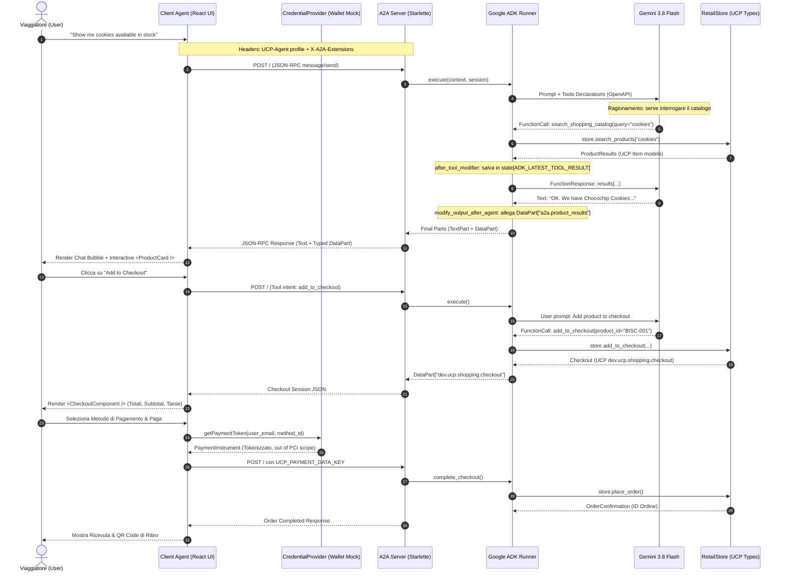
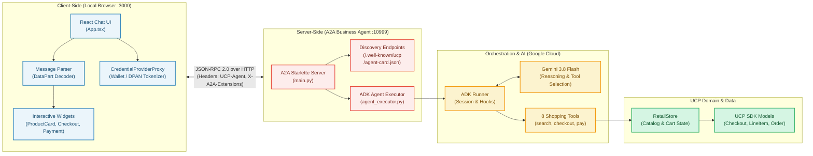

# Runbook Operativo: Slot 1 (Esplorazione & Baseline Locale)

Questo documento contiene la guida passo-passo con i comandi PowerShell per avviare, testare e ispezionare tutti i servizi locali previsti per la **Fase 1 (Ore 0 - 4)** della demo per il GDG DevFest 2026 Milano.

---

## 0. Prerequisiti di Sistema

Verifica che nel tuo ambiente siano installati:
- **Python:** >= 3.11 (`python --version`)
- **UV:** Package manager ultra-rapido (`uv --version`)
- **Node.js & npm:** >= 18.x (`node -v` e `npm -v`)
- **Google API Key:** Chiave API gratuita generata da [Google AI Studio](https://aistudio.google.com/apikey)

---

## 0.1 Attivazione Variabile d'Ambiente per Sessione (`activate-env.ps1`)

Per evitare conflitti con altri progetti sul tuo computer, la chiave `GOOGLE_API_KEY` viene letta dal file `.env` e impostata **esclusivamente per la sessione corrente del terminale** tramite [scripts/activate-env.ps1](file:///c:/Projects/AgenticCommerce/prjs/ucp-demo-mi-devfest2026/scripts/activate-env.ps1).

All'apertura di ogni terminale in cui vuoi avviare i server demo, esegui:
```powershell
. c:\Projects\AgenticCommerce\prjs\ucp-demo-mi-devfest2026\scripts\activate-env.ps1
```


---

## 1. Mappa delle Porte e dei Servizi

| Servizio | Stack | Porta | Endpoint Principale | Scopo |
| :--- | :--- | :--- | :--- | :--- |
| **UCP Reference Server** | FastAPI / Python | `8182` | `http://localhost:8182/.well-known/ucp` | Discovery, API REST Checkout, Firme RFC 9421 |
| **Cymbal Retail Agent** | Google ADK / A2A | `10999` | `http://localhost:10999/.well-known/agent-card.json` | Agente shopping intelligente Gemini + protocollo A2A |
| **Chat Client UI** | React + Vite | `3000` | `http://localhost:3000/` | Interfaccia grafica di acquisto conversazionale |

---

## 2. Step 1.1: UCP Reference Server (REST & Discovery)

### 2.1 Inizializzazione Database & Avvio Server
Apri una finestra **PowerShell (Terminale 1)**:

```powershell
# 1. Posizionati nella directory del server
cd c:\Projects\AgenticCommerce\prjs\ucp-samples\rest\python\server

# 2. Sincronizza le dipendenze
uv sync

# 3. Crea la cartella per i database SQLite di test
New-Item -ItemType Directory -Force -Path "C:\tmp\ucp_test"

# 4. Popola i database con il catalogo prodotti e le transazioni
uv run import_csv.py `
    --products_db_path="C:\tmp\ucp_test\products.db" `
    --transactions_db_path="C:\tmp\ucp_test\transactions.db" `
    --data_dir="c:\Projects\AgenticCommerce\prjs\ucp-conformance\test_data\flower_shop"

# 5. Avvia il server UCP sulla porta 8182
uv run server.py `
    --products_db_path="C:\tmp\ucp_test\products.db" `
    --transactions_db_path="C:\tmp\ucp_test\transactions.db" `
    --port=8182 `
    --allow_insecure_profile_urls
```

> **Nota:** Il parametro `--allow_insecure_profile_urls` è essenziale in ambiente di test locale per consentire la risoluzione dei profili su `http://localhost`.

---

### 2.2 Verifica della Discovery UCP
Apri un secondo terminale **PowerShell (Terminale 2)**:

```powershell
curl.exe -s http://localhost:8182/.well-known/ucp | ConvertFrom-Json | ConvertTo-Json -Depth 6
```

**Cosa verificare nel payload JSON:**
- `ucp.services["dev.ucp.shopping"]`: Specifica l'endpoint base `http://localhost:8182/` e lo schema OpenAPI.
- `ucp.capabilities`: Le capability esposte (`dev.ucp.shopping.checkout`, `cart`, `order`, `discount`, `fulfillment`).
- `ucp.payment_handlers`: Gli handler di pagamento registrati (`com.google.pay`, `dev.shopify.shop_pay`, `mock_payment_handler`).
- `signing_keys`: La chiave pubblica JWK con cui il merchant firma digitalmente ogni risposta o webhook.

---

### 2.3 Esecuzione del Client "Happy Path"
Nello stesso **Terminale 2**, esegui lo script del client:

```powershell
cd c:\Projects\AgenticCommerce\prjs\ucp-samples\rest\python\client\flower_shop
uv sync
uv run simple_happy_path_client.py --server_url=http://localhost:8182
```

**Flusso osservabile a terminale:**
1. **Discovery:** Interrogazione di `/.well-known/ucp`.
2. **Create Session:** Creazione di una sessione di checkout con stato `incomplete`.
3. **Add Items:** Aggiunta di articoli (es. `bouquet_roses`) al carrello.
4. **Apply Discount:** Applicazione del codice promozionale (es. `10OFF`).
5. **Fulfillment Selection:** Calcolo delle opzioni di consegna e selezione destinazione.
6. **Payment Complete:** Conclusione con stato `completed` e generazione dell'ID ordine.

---

## 3. Step 1.2: Cymbal Retail Agent (A2A + Google ADK + Gemini)

Questo componente dimostra come un LLM (Gemini) agisce come Business Agent esponendo le capability UCP tramite il protocollo Agent-to-Agent (A2A).

### 3.1 Avvio del Business Agent Backend
Apri una nuova finestra **PowerShell (Terminale 3)**:

```powershell
cd c:\Projects\AgenticCommerce\prjs\ucp-samples\a2a\business_agent
uv sync

# Avvia l'agente UCP / A2A su porta 10999 (usa il .env sincronizzato dallo script)
uv run business_agent
```

Verifica immediata nel browser o con curl:
- **Agent Card (A2A):** `http://localhost:10999/.well-known/agent-card.json`
- **UCP Profile:** `http://localhost:10999/.well-known/ucp`

---

### 3.2 Avvio del Chat Client (React + Vite)
Apri una nuova finestra **PowerShell (Terminale 4)**:

```powershell
cd c:\Projects\AgenticCommerce\prjs\ucp-samples\a2a\chat-client
npm install
npm run dev
```

Apri il browser su: **`http://localhost:3000`**

### 3.3 Test della Conversazione & Rendering UCP
All'interno dell'interfaccia di chat:
1. **Query catalogo:** Invia *"Show me cookies available in stock"*.
   - *Sotto il cofano:* L'agente invoca il tool `search_shopping_catalog` e ritorna gli articoli formattati secondo lo schema `ProductCard`.
2. **Aggiunta al checkout:** Clicca sul pulsante **Add to Checkout**.
   - *Sotto il cofano:* Viene creata la sessione UCP Checkout (`add_to_checkout`).
3. **Completamento dati & Pagamento:** Segui le richieste dell'agente (indirizzo/dati acquirente) e seleziona il metodo di pagamento mock.
4. **Ordine Confermato:** Ricevi l'oggetto `OrderConfirmation` con riepilogo e ID ordine.

---

### 3.4 Architettura di Comunicazione: Client Agent vs Server Agent

Questa sezione illustra nel dettaglio come sono strutturati i due agenti, come negoziano le capability e come il meccanismo di **Prompting + Function Calling** alimenta la UI del client.

#### A. I Ruoli Architetturali

```mermaid
flowchart LR
    %% Palette colors
    classDef client fill:#EBF5FB,stroke:#2980B9,color:#1B4F72,stroke-width:2px;
    classDef server fill:#FDEDEC,stroke:#E74C3C,color:#78281F,stroke-width:2px;

    subgraph ClientBox ["CLIENT AGENT (React / Vite :3000)"]
        direction TB
        C1["User Chat Interface"]
        C2["UCP Profile Host (/profile/agent_profile.json)"]
        C3["Structured Message Parser (DataPart Decoder)"]
        C4["CredentialProviderProxy (Wallet / Passkey Mock)"]
        C5["Interactive UCP Renderers (ProductCard, Checkout, Pay)"]
    end

    subgraph ServerBox ["SERVER AGENT (Cymbal Retail / ADK :10999)"]
        direction TB
        S1["A2A Starlette Server (JSON-RPC 2.0 Router)"]
        S2["UCP Discovery (/.well-known/ucp & agent-card.json)"]
        S3["ADK Runner & Session Service (google.adk)"]
        S4["LLM Engine (Gemini 3.8 Flash + Tool Calling)"]
        S5["RetailStore & Domain Models (UCP SDK Models)"]
    end

    ClientBox <===>|"A2A Protocol (JSON-RPC 2.0)<br/>Headers: UCP-Agent & X-A2A-Extensions"| ServerBox

    class ClientBox,C1,C2,C3,C4,C5 client;
    class ServerBox,S1,S2,S3,S4,S5 server;
```



1. **Client Agent (Frontend React + Vite su porta 3000):**
   - Non è un banale visualizzatore di testo. Agisce come **agente delegato dell'utente** (*User Agent*).
   - Espone un proprio profilo UCP (`/profile/agent_profile.json`) e invia ogni richiesta via JSON-RPC 2.0 con gli header `UCP-Agent` e `X-A2A-Extensions`.
   - **Parser Polimorfico delle Risposte:** Quando riceve i `parts[]` dal server, decodifica sia il linguaggio naturale (`TextPart`) sia i payload semantici (`DataPart`):
     - `a2a.product_results` ➔ Renderizza il componente interattivo `<ProductCard />` con immagine, prezzo e pulsante d'azione.
     - `dev.ucp.shopping.checkout` ➔ Renderizza il widget `<CheckoutComponent />` con subtotal, tasse, sconti e opzioni di fulfillment.
     - `paymentMethods` ➔ Renderizza `<PaymentMethodSelector />`.
   - **CredentialProviderProxy:** Simula il wallet sicuro del dispositivo. Quando l'utente seleziona una carta, il proxy tokenizza le credenziali senza mai esporre dati sensibili in chiaro nel prompt dell'LLM.

2. **Server Agent (Business Agent Python su porta 10999):**
   - Rappresenta il **Merchant Agent**.
   - Espone `/.well-known/agent-card.json` (per la discovery A2A) e `/.well-known/ucp` (per le capability UCP e i payment handlers).
   - Riceve le chiamate JSON-RPC su `POST /` (`method: "message/send"`), estrae il contesto di sessione (`InMemorySessionService`) e passa il controllo all'**ADK Runner**.
   - **LLM Reasoning & Function Calling (Gemini 3.8 Flash):** L'LLM non genera JSON statici; analizza il prompt dell'utente ed emette chiamate di funzione tipizzate (*Tool Calling*).
   - **RetailStore & UCP SDK:** I tool Python invocati eseguono operazioni reali sul catalogo e istanziano modelli Pydantic validati secondo lo standard UCP (`ucp-sdk`).

---

#### B. Il Ciclo di Function Calling & Hooking ADK

Il server utilizza due hook chiave definiti in `agent.py`:
- **`after_tool_callback (after_tool_modifier)`:** Non appena un tool UCP (es. `search_shopping_catalog` o `add_to_checkout`) termina con successo, questo hook intercetta il risultato e lo salva nello stato di sessione ADK (`ADK_LATEST_TOOL_RESULT`).
- **`after_agent_callback (modify_output_after_agent)`:** Prima che la risposta finale venga restituita all'A2A Server, questo hook estrae il dato strutturato dallo stato e lo impacchetta come `FunctionResponse` / `DataPart` tipizzato all'interno della risposta A2A.

In questo modo la risposta inviata al client contiene **sia** la spiegazione in linguaggio naturale ("Ecco i biscotti disponibili..."), **sia** l'oggetto JSON puro che abilita il rendering grafico del frontend.

---

#### C. Sequence Diagram: Flusso di Chiamata End-to-End



---

#### D. Component Architecture Diagram



---

---

## 4. Step 1.3: Analisi ed Esecuzione dei Mandati Crittografici AP2

Nel talk della DevFest metterai a confronto la differenza tra un semplice pagamento via API e la vera sicurezza agentica garantita da **AP2 (Agent Payments Protocol)**.

### 4.1 I Tre Mandati Fondamentali dello Standard AP2
1. **IntentMandate:** Emesso dall'utente/wallet verso l'agente. Definisce i vincoli e il limite di spesa massimo (es. *"Spesa massima 50€ per caffè e accessori"*).
2. **CartMandate:** Emesso e firmato digitalmente dal Merchant. Attesta crittograficamente il prezzo, le tasse e la disponibilità degli articoli, impedendo all'agente o a terzi di alterare il carrello.
3. **PaymentMandate:** Firmato crittograficamente con autenticazione biometrica dell'utente (FIDO2 / Passkey / TouchID). Autorizza la banca/PSP a scalare l'importo concordato senza esporre il numero di carta all'LLM.

---

### 4.2 Come Eseguire la Demo AP2 con il `MandateViewer`

Il repository `c:\Projects\AgenticCommerce\prjs\AP2` include sia il backend dei 4 agenti A2A, sia un Web Client React con il tab **`Mandates`** (*MandateViewer*) che visualizza in tempo reale le credenziali firmate.

#### 1. Avviare i microservizi AP2
Nel repository `AP2` ogni ruolo gira su una porta dedicata:
- `Merchant Agent`: porta `8001`
- `Credentials Provider (Wallet)`: porta `8002`
- `Merchant Payment Processor`: porta `8003`
- `Shopping Agent`: porta `8000`

Apri un terminale PowerShell in `c:\Projects\AgenticCommerce\prjs\AP2`:
```powershell
cd c:\Projects\AgenticCommerce\prjs\AP2
. c:\Projects\AgenticCommerce\prjs\ucp-demo-mi-devfest2026\scripts\activate-env.ps1
uv sync --package ap2-samples

# Avvia l'orchestratore e i ruoli
uv run --package ap2-samples python -m roles.merchant_agent
```
*(Oppure segui il `README.md` di scenario in [AP2/code/samples/python/scenarios/a2a/human-present/cards](file:///c:/Projects/AgenticCommerce/prjs/AP2/code/samples/python/scenarios/a2a/human-present/cards/README.md))*.

#### 2. Avviare il Web Client con MandateViewer
In un altro terminale PowerShell:
```powershell
cd c:\Projects\AgenticCommerce\prjs\AP2\code\web-client
npm install
npm run dev
```

Apri il browser su `http://localhost:5173`:
1. Interagisci nella chat chiedendo un prodotto (es. *"I want to buy a coffee maker"*).
2. Spostati sul tab **`Mandates`**: vedrai comparire le schede interattive:
   - **`Open Mandates`**: SD-JWT emesso dal wallet.
   - **`Checkout JWT`**: Carrello firmato dal merchant.
   - **`Closed Mandates` & `Mandate Chains`**: La catena crittografica completa e non ripudiabile.

---

### 4.3 Il Ponte tra UCP e AP2: L'Estensione `dev.ucp.payment.ap2_mandates`
Nella specifica ufficiale UCP ([specification/payment/extensions/ap2-mandates.md](file:///c:/Projects/AgenticCommerce/prjs/ucp/specification/payment/extensions/ap2-mandates.md)):
- UCP dichiara l'estensione `dev.ucp.payment.ap2_mandates`.
- Il server UCP incapsula il `CartMandate` firmato direttamente all'interno dell'oggetto `Checkout` UCP.
- Il client invia il `PaymentMandate` firmato biometricamente per finalizzare la transazione.
Questo dimostra al pubblico della DevFest come i due standard convergono in un'unica architettura coerente.

---

## 4.4 Novità: Live Protocol Inspector Integrato in Demo 1 (`chat-client`)

Per mantenere la massima coerenza visiva e didattica durante la presentazione, anche **Demo 1** (`chat-client`, porta `4200`) include il **Live Protocol Inspector**, condiviso come componente riutilizzabile da `@ucp/shared-frontend`:

1. **Collassato di Default (Regia del Talk):**
   - All'apertura della demo, la chat appare pulita e a tutta larghezza (UX fluida per l'utente finale).
2. **Attivazione in 1-Click:**
   - Clicca sul pulsante **`🔍 Mostra Inspector`** in testata.
   - L'interfaccia si trasforma istantaneamente in uno **Split-View** ad alta risoluzione (Chat 50% / Inspector 50%).
3. **Cosa Mostra l'Inspector in Demo 1:**
   - **`A2A_PROMPT_SEND`**: Pacchetto di richiesta JSON-RPC 2.0 (`message/send`) con intestazioni di conformità `X-A2A-Extensions` e `UCP-Agent: profile=...`.
   - **`A2A_MESSAGE_RESPONSE` / `A2A_UCP_CHECKOUT_EVENT`**: Risposta semantica del Merchant Agent con latenza di rete reale (`⚡ ms`) e payload UCP tipizzato (`a2a.ucp.checkout`, `a2a.product_results`).
   - **`A2A_COMPLETE_PAYMENT_AP2`**: Riscontro delle credenziali crittografiche hardware inviate per la finalizzazione dell'ordine (`a2a.ucp.checkout.risk_signals`).

---

## 5. Comandi Utili per Gestione Processi su Windows

Se una porta risulta occupata (`8182`, `10999`, o `3000`), puoi liberarla rapidamente con questo comando PowerShell:

```powershell
# Esempio per liberare la porta 8182
Get-Process -Id (Get-NetTCPConnection -LocalPort 8182).OwningProcess | Stop-Process -Force

# Esempio per liberare la porta 10999
Get-Process -Id (Get-NetTCPConnection -LocalPort 10999).OwningProcess | Stop-Process -Force
```
