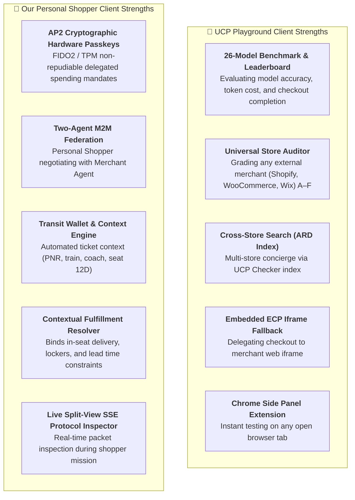

# UCP Feature Mapping: UCP Playground vs. Our Personal Shopper Client

> **Comparative analysis strictly focused on the Buyer Agent / Personal Shopper Client scope:**  
> `ucpplayground.com` (Buyer Agent Harness & Inspector) vs. our **Personal Shopper Client Architecture** ([`shopper-client`](../apps/shopper-client) :4203 + [`backend-shopper`](../backend-shopper) :10998, and roadmap [`ucp-web-client`](../TODO.md#L134)).  
> *Target Specifications:* Universal Commerce Protocol (UCP v2026-04-08 / v2026-08-25), Agent Payment Protocol (AP2), Model Context Protocol (Web MCP), RFC 9421 HTTP Message Signatures.  
> *Scope Alignment:* UCP Playground is strictly an **Agent Platform / Buyer Agent Client Harness** (advertising `/.well-known/ucp-agent` and sending `UCP-Agent` headers to stores). This document maps its client features against our **Personal Shopper Client**.

---

## 1. Executive Overview & Client Positioning

Both solutions operate as **AI Buyer Agents / Personal Shoppers** that connect to external or local UCP-compliant merchants to perform discovery, product research, and checkout orchestration:

| Dimension | UCP Playground (`ucpplayground.com`) | Our Personal Shopper Client (`shopper-client` + `backend-shopper`) |
| :--- | :--- | :--- |
| **Primary Role** | **Universal Buyer Agent & Multi-Model Benchmark Harness**: Client orchestrator designed to probe, inspect, and benchmark 26 LLMs against external UCP merchants. | **Vertical Personal Shopper & Transactional Delegator**: Context-aware AI assistant that autonomously negotiates combos, binds travel context, and signs AP2 spending mandates. |
| **Client Software Stack** | Cloud Web UI + Chrome Side Panel Extension (`v0.10.34`) + Python/Node headless benchmarking orchestrator. | Angular 22 Split-View UI (`:4203`) + Python/Starlette Personal Shopper Service (`:10998`) powered by Gemini 2.5 Flash + Web Crypto Signer. |
| **Payment Delegation** | **Simulated / Delegated Web**: The agent *"never pays"* directly; it uses test cards (`tok_visa`), simulates checkout, or hands off to an Embedded ECP iframe. | **Hardware-Backed Cryptographic Mandates (AP2)**: Local Credential Manager (LCM) modal with Passkey FIDO2/TPM hardware authorization and SD-JWT delegated spending envelope. |
| **Agent Reasoning Pattern** | Single-agent tool-calling loop (1 model calling store tools sequentially). | **Federated Multi-Agent Reasoning**: Personal Shopper formulates M2M inquiries and negotiates with the Merchant Agent via Pydantic structured outputs. |
| **Fulfillment Configuration** | Standard address input and lodging room holds (`hotel.local`). | **Transit & Location-Aware Fulfillment**: Binds train coach/seat (`in_seat_train`) or Smart Locker (`pickup_locker`) directly into the checkout payload. |

---

## 2. Deconstruction of UCP Playground Features (from Changelog)

Based on an exhaustive analysis of the [UCP Playground Changelog](https://ucpplayground.com/changelog) (from release `v0.1.0` through `v0.22.9`, October 2026), the platform provides seven core subsystem features:

### 2.1 The Tool Inspector & Multi-Transport Gateway
* **Protocol Transports**: Connects via **UCP over MCP** (JSON-RPC), **UCP over REST** (HTTP/1.1-2), **Store-page WebMCP** (browser tools registered directly by storefront DOM), and **Embedded (ECP)** iframe transport.
* **Negotiation Readout**: 5-step handshake visualization: (1) Discovery, (2) Version selection, (3) Capability intersection, (4) Extension resolution, (5) Activation.
* **Held State Mirroring**: Real-time panel tracking whatever the merchant has issued an identifier for (cart, checkout, room hold, reservation, expiry, error codes).
* **Wire-Level Inspector**: Expanded inspection showing method, URL, headers (`Request-Id`, `Content-Digest`, `Signature`, `Idempotency-Key`), and raw payloads.

### 2.2 The Agent Benchmark & Model Comparison Harness
* **26 Frontier Models**: Claude Opus 5 / Sonnet 5, Gemini 3.8 / 3.7 / 3.5 Flash / 3.1 Pro, GPT-6 Luna / GPT-5.5, DeepSeek V4.1 / R1 (with collapsible reasoning chain), Qwen 3.8 / 3.7 Max, Grok 4.5, Muse Spark 1.3.
* **Multi-Model Split Comparison**: Executes 2–5 models simultaneously against the same merchant endpoint with synchronized timelines and token/duration summaries.
* **Prompt Caching & Token Meters**: Explicit caching markers for Google and Anthropic; per-run token ceilings and runaway loop prevention.
* **Agent Self-Defense (Prompt Injection Guardrails)**: Treats merchant tool responses (catalog, reviews, terms) as untrusted third-party information; follows guidance on tool sequencing but rejects instruction hijacking.

### 2.3 Store Auditing & Schema Quality Engine
* **4-Phase Conformance Audit**: Manifest discovery, MCP initialize, search probe, capability scoring (0–100, letter grades A–F).
* **Schema Validation & Sanitization**: Strips invalid placeholders, fixes empty arrays/objects, coerces types, validates reverse-DNS authority binding.
* **Platform Adapters**: Tailored detection and handling for Shopify (legacy `/api/mcp` and modern `/api/ucp/mcp`), WooCommerce, Magento, and Wix.

### 2.4 Browser-Native WebMCP & Chrome Extension
* **Chrome Side Panel (`v0.10.34`)**: Automatically detects `/.well-known/ucp` on any visited e-commerce site, connecting via Personal Access Tokens.
* **Store-Page WebMCP Execution (`v0.22.0`)**: Navigates the store's web page directly using DOM-registered tools, capturing step-by-step screenshots and UI replays up to the checkout page.

### 2.5 Security, Signatures & Identity Linking
* **RFC 9421 HTTP Message Signatures**: ECDSA-P256 signing of outbound REST and MCP requests, advertising platform profile at `/.well-known/ucp-agent`.
* **Idempotency Stability**: Deterministic UUID generation across retries covering state-changing requests.
* **Identity Linking (`dev.ucp.common.identity_linking`)**: RFC 8414 auth server discovery, RFC 7591 dynamic client registration, RFC 9728 protected-resource metadata, PKCE S256, and challenge handling (`identity_required`, `insufficient_scope`, `invalid_token`).
* **Verified Order Webhooks**: Accepts business $\to$ platform webhooks at `/webhooks/ucp/orders` verifying RFC 9421 signatures and order ownership.

### 2.6 Multi-Store Concierge ("Shop All Stores")
* Leverages UCP Checker's **Agentic Resource Discovery (ARD)** index to search across thousands of verified UCP merchants, select the best candidate, and transact directly using merchant tools.

### 2.7 Verticals & Lodging Engine (`v0.17.0`)
* Dedicated support for draft `dev.ucp.lodging.booking` on `hotel.local`: Search Stays, Rate, Review, Hold Room, Book, Disclosures, Cancellation policies, and payment terms breakdown.

---

## 3. Comprehensive 3-Way Feature Matrix

Legend:
* ✅ **Implemented**: Fully operational in production/live demo code.
* 🟡 **Partial / Adapted**: Implemented with specific architectural trade-offs or simulated components.
* 📋 **Planned / Roadmap**: Formalized in project backlog (`TODO.md`).
* ⚪ **Out of Scope**: Not applicable to the project's target domain.

| # | Feature / Capability Domain | Normative UCP Spec / Standard | UCP Playground (`ucpplayground.com`) | Our Demo Client (`ucp-demo-mi-devfest2026`) | Planned Evolution (`TODO.md`) |
| :-: | :--- | :--- | :--- | :--- | :--- |
| **A** | **DISCOVERY & HANDSHAKE** | | | | |
| A1 | Well-Known Manifest (`/.well-known/ucp`) | **MUST** (Core) | ✅ Probes and displays merchant manifests with TTFB latency checks. | ✅ Implemented in `ucp_rest_server.py` (`get_ucp_manifest`). | Active in all demos. |
| A2 | Agent Platform Profile (`/.well-known/ucp-agent`) | **SHOULD** (UCP 2026-08-25) | ✅ Serves public JWKS profile with `keys` and capability declarations. | 🟡 Local mock profile (`shopper_agent.json`). | [TODO-01] Formalize public hosted profile. |
| A3 | Capability Intersection Algorithm | **MUST** (Core) | ✅ 5-stage mathematical intersection and exclusion readout. | 🟡 Advertised in manifests; static local intersection. | [TODO-12] Dynamic in-browser intersection in `ucp-web-client`. |
| A4 | Reverse-Domain Authority Binding | **MUST** (Core) | ✅ Validates that `dev.ucp.*` origins resolve to `ucp.dev`. | ✅ Strict reverse-domain naming across all routes. | Built into shared models. |
| **B** | **TRANSPORTS & BINDINGS** | | | | |
| B1 | UCP REST Binding | **MUST** (if supported) | ✅ REST catalog exploration, checkout session creation, PUT updates. | ✅ Fully implemented with FastAPI/Starlette in `ucp_rest_server.py`. | Core of Demo 4. |
| B2 | UCP MCP (Model Context Protocol) | **MAY** (Transport) | ✅ Full JSON-RPC over Streamable HTTP with tools discovery (`tools/list`). | ✅ Implemented on `/mcp/tools` with 7 tools in `mcp_server.py`. | Core of Demo 2. |
| B3 | WebMCP (In-Browser Store Page Tools) | Emerging Standard | ✅ Store-page WebMCP route with screenshots and replay (v0.22.0). | ✅ Live interactive web storefront exposing tools in DOM (`storefront-webmcp`). | [TODO-05], [TODO-06] In-browser Chrome Extension WebMCP agent. |
| B4 | Semantic Agent-to-Agent (A2A) M2M | **MAY** (Federation) | 🟡 A2A transport tab recognized; single-agent orientation. | ✅ **Full Two-Agent Federation**: Personal Shopper $\longleftrightarrow$ Merchant Agent (Gemini 2.5 Flash). | [TODO-01] Upgrade to standard `a2a.ucp.checkout` JSON-RPC DataPart. |
| B5 | Embedded Commerce Protocol (ECP / iframe) | **OPTIONAL** (Transport) | ✅ Bottom-sheet iframe overlay with `window.postMessage` / `MessagePort`. | ⚪ Headless/direct agentic model; bypasses nested iframes. | Human-in-the-loop handled via native Passkey modal. |
| **C** | **SHOPPING & CHECKOUT LIFECYCLE** | | | | |
| C1 | Catalog Search & Lookup | **RECOMMENDED** | ✅ Supports `catalog.search`, `catalog.lookup`, handles nested filters. | ✅ `GET /ucp/catalog/products` with category & thermal filtering. | [TODO-07] Firestore Vector Search embeddings. |
| C2 | Checkout Sessions Lifecycle | **MUST** | ✅ Manages `incomplete` $\to$ `ready_for_complete` $\to$ `completed`. | ✅ Explicit state machine in `bopis_store.py` and `ucp_rest_server.py`. | Core of Demo 4. |
| C3 | Checkout Updates (PUT/PATCH) | **MUST** (UCP 2026-08-25) | ✅ Sends complete checkout via `PUT` preserving unmutated fields. | ✅ Supports mutation of line items and fulfillment selection. | [TODO-03] ETag / If-Match optimistic locking. |
| C4 | Monetary Minor Units & Currency | **MUST** | ✅ Formats cents/minor units (e.g. 1290 BRL $\to$ R$12.90, JPY no decimals). | ✅ Strictly enforced: `price_cents`, `currency: "EUR"`. | Used across all schemas. |
| C5 | Cart-to-Checkout Conversion | **RECOMMENDED** | ✅ Detects `convert_cart` and unified cart tools. | 🟡 Direct creation of checkout from intent/cart. | [TODO-12] Standalone client cart engine. |
| C6 | Multi-Item Bundling & Combos | Retail Extension | 🟡 Model-prompted bundling. | ✅ **Autonomous Combo Negotiation**: Gemini 2.5 pairs espresso + focaccia with promotional discount. | [TODO-11] Disjunctive OR query optimization. |
| **D** | **SECURITY, SIGNATURES & CRYPTOGRAPHY** | | | | |
| D1 | RFC 9421 HTTP Message Signatures | **MUST** (for secure auth) | ✅ ECDSA-P256 signing covering `@authority`, `@path`, `content-digest`, `idempotency-key`. | ✅ **Implemented in `rfc9421.py`**: verifies signature and RFC 9530 digest. | Core security of Demo 4. |
| D2 | Deterministic Idempotency Keys | **MUST** (Mutations) | ✅ Deterministic UUIDv4 derived from resource to prevent double-charging. | 🟡 UUIDv4 generated per checkout/order session. | Enterprise deduplication store. |
| D3 | AP2 Passkey Mandates (FIDO2 / SD-JWT) | AP2 Standard | ⚪ **Not supported** (Playground *"never pays"*, stops at checkout wall or delegates to iframe). | 🟡/✅ **Protocollo Attivo & Hardware Emulato**: Ciclo LCM, claims SD-JWT e controllo tetto di spesa attivi; WebAuthn e firma asimmetrica emulati per demo offline. | [TODO-02] Demo 5 Headless Delegated Mode; migrazione a WebAuthn reale. |
| D4 | Verified Order Webhooks | **RECOMMENDED** | ✅ Inbound webhook receiver at `/webhooks/ucp/orders` with RFC 9421 verification. | ✅ Station Dispatcher webhook push via Google Cloud Firestore. | Real-time push to staff screen. |
| **E** | **IDENTITY & CONTEXT INJECTION** | | | | |
| E1 | Identity Linking (OAuth2 + PKCE) | **OPTIONAL** | ✅ Full RFC 8414 discovery, RFC 7591 dynamic registration, RFC 9728 metadata, PKCE S256. | 🟡 **Mode 1 Declared Email Matching**; Firebase Auth OIDC integration. | Modes 2 & 3 in roadmap. |
| E2 | Buyer Location & Geolocation Context | **OPTIONAL** | ✅ Injects place, coordinates, timezone into system prompt (`buyer_context`). | ✅ **Traveler Ticket Context**: Injects train PNR, carriage number, seat (12D), departure time. | Tailored to transit retail. |
| E3 | Anti-Prompt Injection Guardrails | Best Practice | ✅ Instructions v1.1: treats tool responses as untrusted third-party data. | ✅ Strict Pydantic Structured Outputs and system prompt sanitization. | Guardrails on both agents. |
| **F** | **PROTOCOL INSPECTION & TOOLING** | | | | |
| F1 | Real-Time Protocol Inspector | Dev Tooling | ✅ Collapsible Wire Log with level-tagged requests, responses, timings. | ✅ **Live Split-View Inspector** in `shopper-client` with real-time SSE stream of protocol steps. | [TODO-12] "Postman for UCP" in `ucp-web-client`. |
| F2 | Replay & Session Sharing | Dev Tooling | ✅ Shareable URLs, fixed content-hashed JSON (`/s/{id}.json`), embeddable iframe player. | 🟡 Local playback and live presentation mode. | Plan to add exportable trace JSON. |
| F3 | Multi-Model Benchmarking / Leaderboard | Evaluation | ✅ Benchmarks 26 models on checkout completion, tokens, duration; public leaderboard. | ⚪ Dedicated to Gemini 2.5 Flash with structured outputs. | Focused on production reliability. |
| F4 | Chrome Side Panel Extension | Tooling | ✅ Side panel detecting `/.well-known/ucp` with PAT auth. | 📋 **Specified in [TODO-05]**: Chrome MV3 side panel with in-browser LLM and WebMCP tools. | High-priority roadmap item. |
| **G** | **CLIENT FULFILLMENT & PHYSICAL CONTEXT RESOLUTION** | | | | |
| G1 | Client Fulfillment Selection (`fulfillment.method`) | `dev.ucp.shopping.fulfillment` | 🟡 Basic address selection & lodging holds. | ✅ **Context-Aware Transit Fulfillment**: Personal Shopper resolves and binds `in_seat_train` (with coach/seat) or `pickup_locker` (with PIN). | Automated from ticket wallet. |
| G2 | Physical Constraint Negotiation | Retail Semantics | ⚪ Client does not model thermal/timing constraints. | ✅ **Shopper Feasibility Check**: Personal Shopper negotiates with merchant factoring in train departure lead times (min 30 min) and item temperature. | Enforced in A2A negotiation. |
| G3 | Transit Ticket & Wallet Binding | Vertical Extension | ⚪ Manual place/coordinates entry (`buyer_context`). | ✅ **Traveler Ticket Ingestion**: Personal Shopper automatically ingests PNR, carriage, seat (12D) into checkout signals. | Frictionless traveler UX. |

---

## 4. Key Architectural Contrasts: Where Each Client Excels

### 4.1 Where UCP Playground Leads
1. **Multi-Model Evaluation & Leaderboard**: Playground is an unbeatable benchmarking suite. Testing how GPT-6, Claude Opus 5, Gemini 3.8, and DeepSeek R1 handle malformed tool schemas or complex checkout parameters provides invaluable empirical data for protocol designers.
2. **Universal Merchant Diagnostic Engine**: Its 4-phase audit engine, TTFB measurement, and automated schema repair (fixing bare arrays or null arguments before they crash the model) make it the premier diagnostic tool for third-party merchants implementing UCP.
3. **Embedded Commerce Protocol (ECP) Handshake**: When an AI agent cannot pay directly, Playground's postMessage/MessagePort bottom-sheet iframe handles the human handoff seamlessly.
4. **Agentic Resource Discovery (ARD)**: Multi-store concierge search allows a shopper to discover items across multiple independent platforms and seamlessly connect to the winning merchant.

### 4.2 Where Our Personal Shopper Client Leads
1. **True Cryptographic Delegation (AP2 vs. Payment Wall)**:
   - *The Playground limitation:* Playground changelog repeatedly highlights that the agent *"never pays"* and stops at the checkout wall or iframe delegation.
   - *Our breakthrough:* Our client implements **Agent Payment Protocol (AP2)**. Using FIDO2/Passkey biometric authentication on the traveler's device, it generates non-repudiable SD-JWT Mandates (Cart & Payment Mandates) that permit the agent to bind and commit funds within authorized cryptographic limits.
   
   > [!NOTE]
   > **Dettaglio di Trasparenza Architetturale (Implementato vs. Simulato nella Demo):**  
   > Per garantire autonomia e ripetibilità offline durante presentazioni e conferenze (senza dipendere da hardware biometrico specifico o carte di credito reali), la demo distingue chiaramente tra protocollo ed emulazione:
   > - **Cosa è Realmente Implementato:** L'intero ciclo di vita UX del Local Credential Manager (LCM), la composizione formale dei claims del token SD-JWT (`iss`, `sub`, `aud`, `order_id`, `mandate_type`, `max_amount_cents`, `iat`, `exp`), l'iniezione del mandato nel payload A2A verso il merchant, la **verifica algoritmica stringente del tetto di spesa sul backend** (`verify_ap2_mandate` respinge matematicamente addebiti superiori al budget approvato), e la persistenza con sincronizzazione real-time su Cloud Firestore.
   > - **Cosa è Simulato / Emulato per la Demo:** Il sensore biometrico è emulato con animazione temporizzata (1.1s) anziché invocare la WebAuthn API fisica (`navigator.credentials.get()`); la firma crittografica del token usa un HMAC simmetrico locale anziché una chiave asimmetrica P-256 nel Secure Enclave/KeyMint; il gateway bancario (MPP) non movimenta denaro reale.

2. **Two-Agent Autonomous Federation (M2M)**:
   - While Playground tests a single agent against merchant tools, our Personal Shopper features autonomous agent-to-agent negotiation, formulating semantic inquiries and resolving combos via Gemini 2.5 Flash structured outputs with the Merchant Agent.
3. **Autonomous Transit & Physical Fulfillment Binding**:
   - E-commerce does not end at digital receipts. Our Personal Shopper binds physical logistics directly into the checkout payload: coach/seat delivery for high-speed trains, pickup lockers, and lead-time compatibility, without forcing the user to manually type destination details.
4. **Context-Rich Automated Personalization**:
   - Instead of asking the user to manually type coordinates or choose shipping addresses, our Personal Shopper automatically extracts traveler wallet context (train, coach, seat 12D) to deliver frictionless service.

---

## 5. Strategic Roadmap & Actionable Inspirations

Studying the evolution of UCP Playground yields concrete improvements for our backlog:

| Inspiration from UCP Playground | Target in Our Roadmap | Concrete Actionable Enhancement |
| :--- | :--- | :--- |
| **Chrome Side Panel (`v0.10.34`)** | **`TODO-05`** | Implement the planned `apps/chrome-extension-webmcp` using Chrome MV3 Side Panel API to run our WebMCP shopping agent directly beside our Angular storefront. |
| **Standalone Web Client (`TODO-12`)** | **`TODO-12`** | Build `apps/ucp-web-client` as an open-source, client-only Angular 22 SPA ("Postman for UCP") featuring our Web Crypto RFC 9421 signer and live Protocol Inspector. |
| **Wire Log & Session Replay (`v0.11.0`)** | **`shopper-client`** | Enhance our Split-View Protocol Inspector with level-tagged wire rows (`REQUEST`, `RESPONSE`, `REASONING`, `SIGNATURE`) and a "Copy Curl / JSON" button. |
| **Multi-Model Selection (`v0.10.28`)** | **`backend-shopper`** | Allow switching between Gemini 2.5 Flash, Gemini 3 Flash, and local models to showcase performance trade-offs during live presentations. |
| **Schema Quality Audit (`v0.6.2`)** | **`backend-merchant`** | Integrate automated JSON Schema linter checks on startup to guarantee our OpenAPI and MCP tool definitions conform to UCP A-grade standards. |
| **Agent Prompt Defenses (`v0.19.1`)** | **`backend-merchant`** | Add explicit untrusted-content demarcation in our Gemini system prompts to guarantee physical retail promotions cannot hijack the shopper agent's goal. |

---

## 6. Conclusion

UCP Playground and our DevFest Demo Client represent the two halves of the ideal Agentic Commerce ecosystem:
* **UCP Playground** is the **Validation, Diagnostic, and Benchmarking Harness** that proves whether a merchant's digital endpoints conform to UCP specifications and how different AI models perform.
* **Our Client Suite (`ucp-demo-mi-devfest2026`)** is the **Vertical Production Blueprint** demonstrating how autonomous agents resolve real-world payments cryptographically via **AP2 Passkeys**, federate machine-to-machine, and coordinate with real physical retail operations.

Together, they demonstrate that UCP is no longer a theoretical specification, but a vibrant, functional protocol ready for production retail.
